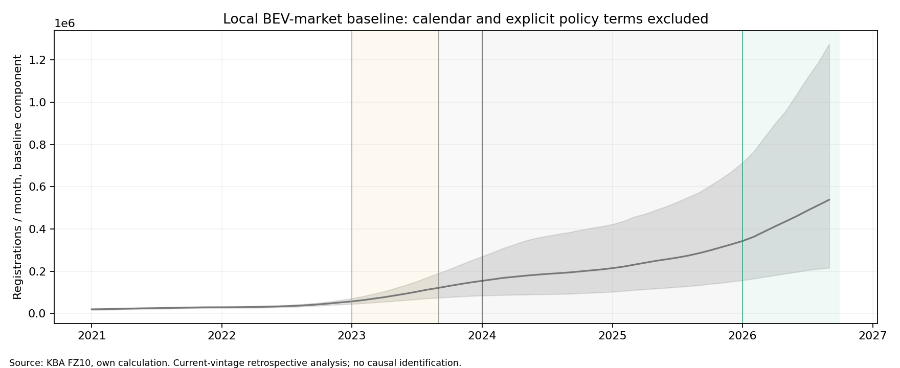
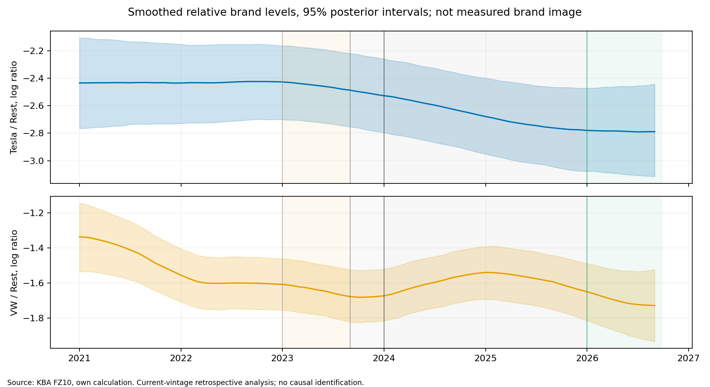
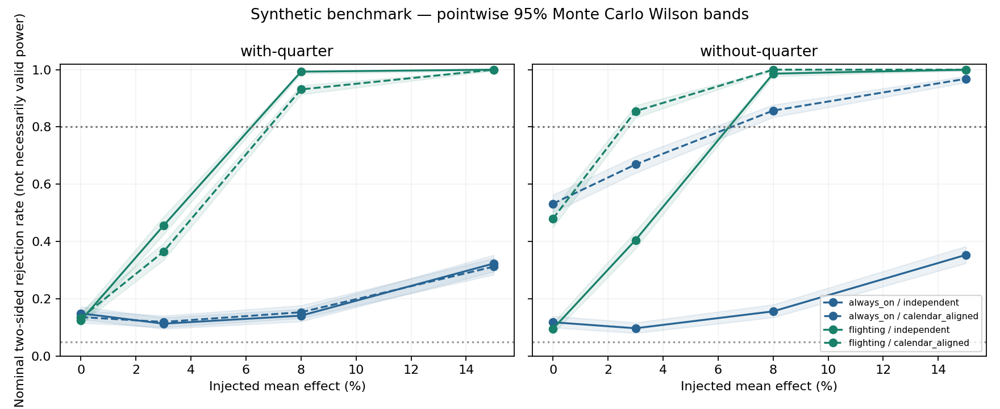

# Agentic Analytics Studio

**Why did Tesla registrations in Germany fall in 2025 and recover in Jan–Sep 2026 —
a changing BEV market, changing Tesla share, or identifiable external drivers?**

Wir untersuchen reale deutsche Neuzulassungen, keine erfundenen Media-Ausgaben.
2025 verlor Tesla deutlich Anteil in einem wachsenden BEV-Markt; 2026 meint hier
ausschließlich Januar bis September gegen dieselben Vorjahresmonate.
Die Zerlegung ist belastbar, ihre Ursachen sind damit noch nicht identifiziert.
Die vollständigen Vergleiche, Unsicherheiten und negativen Befunde bleiben einsehbar.

## What the observed data establish

| Comparison | Tesla registrations | Official BEV market | Tesla change: market component / share component |
|---|---:|---:|---:|
| 2024 vs 2023 | −41.0% | −27.4% | −15,812 / −10,299 |
| 2025 vs 2024 | −48.4% | +43.2% | +11,048 / −29,232 |
| Jan–Sep 2026 vs Jan–Sep 2025 | +201.9% | +58.1% | +12,541 / +17,424 |

In 2025, market growth offset part of a much larger Tesla share loss.
Relative erosion was already present in 2023; the table does not establish
brand controversy, price competition or Model Y changeover as the cause.
Both market and share contributed to the matched-period 2026 increase.


Source: Kraftfahrt-Bundesamt FZ10, own calculation. Monthly reference dates;
policy markers: January 2023 grant cut, September 2023 private eligibility,
January 2024 first full post-end month, January 2026 new programme.
Administrative counts receive no invented sampling intervals.

## What the model tests support

| Hypothesis | Test | Result | Reason |
|---|---|---|---|
| H-T: Tesla lost ground in 2025 | Exact market/share accounting | Supported | Tesla −48.4%, market +43.2%; individual causes remain unidentified. |
| H-T: lower latent Tesla level | 2025–2024 ALR contrast | Open | Primary −0.142 [−0.297,0.014]; stronger negative estimates with wider state SDs. |
| H-P: policy adds predictive information | M2 vs M0/M1, both years/horizons | Open | Stable 2026 advantage; M0 wins in 2025. |
| H-C: China price competition | Not examined | Open | Basket allocation and comparable price history incomplete. |
| H-F: persistent fuel effect | Not examined | Open | Outside Stage 1. |
| H-D: diffusion/buyer transition | Not examined | Open | No admitted buyer-type/stock proxy in this fit. |

Full results: [computed report](results/task04/stage1/report.md),
[scientific assessment](results/task04/SCIENTIFIC_REVIEW.md),
[all comparisons](results/task04/stage1/metrics.csv).
Conditional predictive improvement is distinct from a causal policy effect.

Primary Tesla innovations retain nonstationarity/serial correlation; VW retains
strong autocorrelation. Forecast intervals are broad and latent levels depend
materially on the state SD. The market baseline below has large compensating
state/policy terms; its values cannot serve as market potential or a defensible
no-subsidy counterfactual.





Source: KBA FZ10, own calculation. Shading represents model-dependent 95%
posterior intervals. Smoothed states use later observations; the
[diagnostic graphic](results/task04/diagnostics/innovation_acf.png) separates
them from conditional filtered estimates. VW means the brand, not the group.

## Why the findings are inspectable

The [frozen Stage 1 protocol](docs/REGIME_STATE_SPACE_PROTOCOL.md) predates real
fitting; development patterns were already known, so this is not an outcome-blind
preregistration. Eight predeclared specifications use 69 observed months,
fixed calendar/policy definitions, strict historical training prefixes,
two forecast horizons, ADF/KPSS and innovation diagnostics.
Source/configuration/output hashes, seeds, software and actual verification
commands are [preserved with the results](results/task04/README.md).
No expiring Actions artifact is needed to read the tables or figures.

The small pre-freeze recovery check was weak: every one of twelve policy
intervals included zero. SD 0.03 had a small planned error advantage, not proof
of the true state variance. Short series, deliveries, fleet mix, changing
eligibility, incomplete price history and an unresolved China basket limit
explanation. Fuel, diffusion and buyer-type transitions were not tested in
Stage 1. See [methods](docs/METHODS.md), [data](docs/DATA.md) and
[limitations](docs/LIMITATIONS.md).

## Earlier synthetic research

[Task 02](results/task02/report.md) tested identifiability across 1,000 seeds
per scenario; its ten original files remain unchanged.
In this design, narrow always-on variation was difficult to recover, and omitted
quarter-end controls produced false confidence: one null rejection rate was 53.2%
with only 46.8% coverage for nominal 95% intervals.
These calibration/sign failures limit power and MDE claims; they do not establish
a universal law about always-on media. Synthetic replacement data were rejected
for the substantive Tesla analysis.



Source: synthetic Task 02 benchmark, not KBA or real marketing ROI.
[Original tables and hashes](results/task02/manifest.json).

## Run the existing pilot

Reading the research above requires no server or API account.
For the separate browser workspace, tested Linux/Python 3.12 setup:

```sh
python3.12 -m venv .venv
.venv/bin/python -m pip install -r requirements-empirical.lock
.venv/bin/python -m demo
```

Open http://127.0.0.1:8000; a fresh workspace does not contain private data.
Research reproduction uses its separate pinned environment:
[commands and verification](results/task04/README.md).
The existing authenticated Azure setup is documented in the
[deployment guide](docs/DEPLOYMENT.md); no cloud/AI access is required here.

## Repository map and attribution

- [`results/`](results/task04/) — preserved numerical research and figures.
- [`regimes/`](regimes/), [`benchmarks/`](benchmarks/task02/) — current analysis and frozen synthetic experiment.
- [`data/`](docs/DATA.md) — public observations/catalogs; private admissions do not imply redistribution.
- [`contracts/`](contracts/README.md) — earlier versioned benchmark interfaces.
- [`docs/`](docs/METHODS.md) and [historical archive](docs/archive/README.md) — active reading guides and provenance.

KBA data: Kraftfahrt-Bundesamt, Flensburg, own calculations,
Datenlizenz Deutschland – Namensnennung 2.0.
Other sources retain their individual attribution, third-party and private-use
limits. No root software license is inferred from data licenses.
