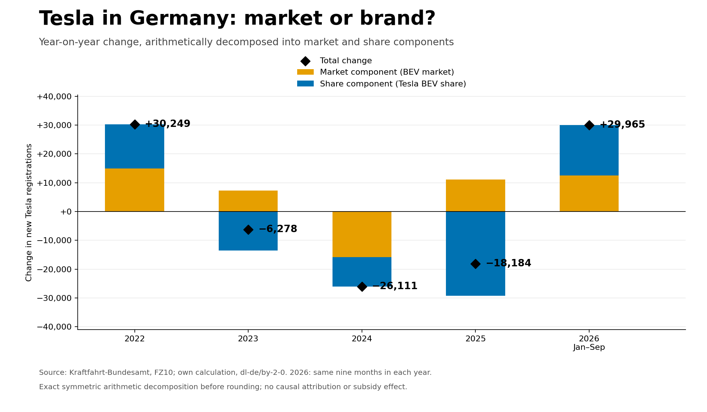
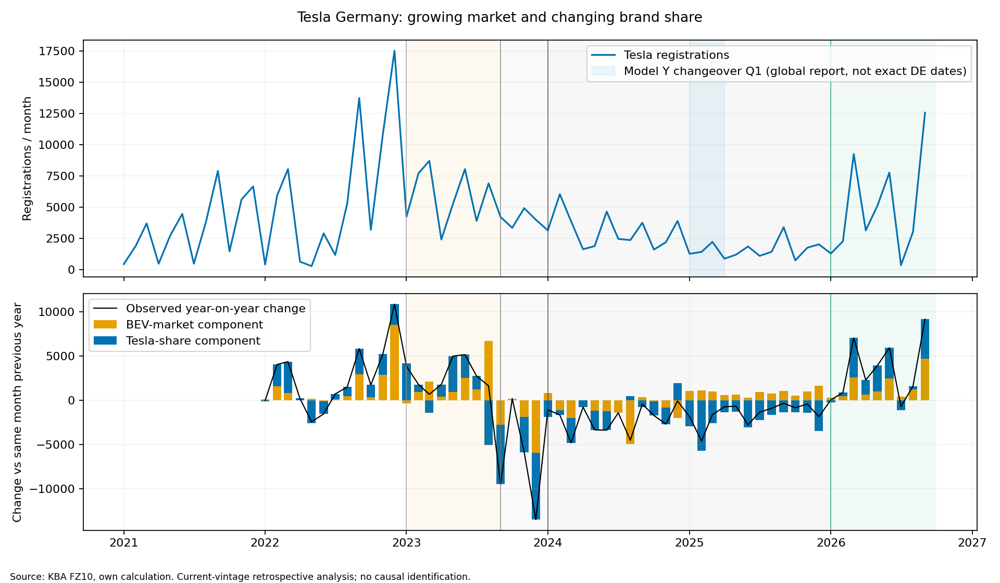
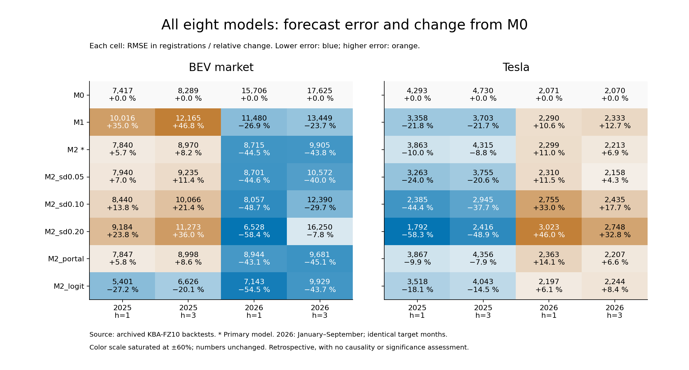
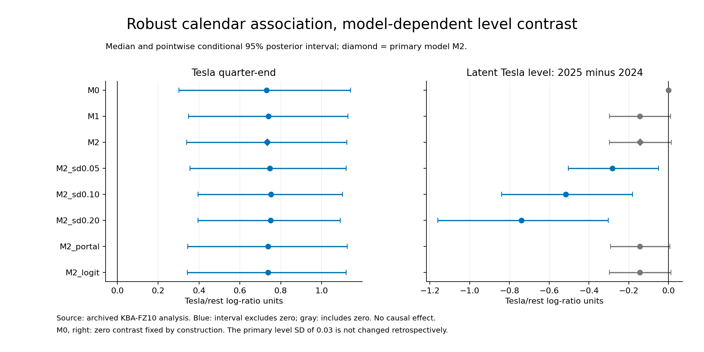
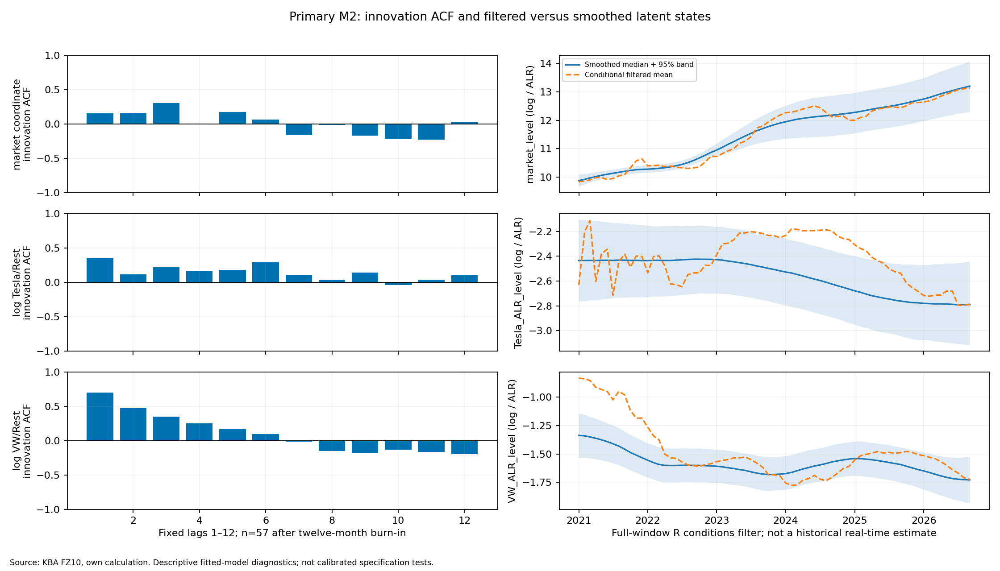

# Agentic Analytics Studio

**What explains the changes in Tesla's new registrations in Germany —
the overall BEV market, brand share, the calendar, or government subsidies?**

The completed **Task 04 Stage 1 analysis** uses 69 real KBA months
from January 2021 through September 2026. Eight predefined joint
state-space models separate market developments from relative brand performance.
This README presents the complete results; the tables and new
figures dated **October 30, 2026** read only the saved run
from **October 29, 2026**. No model was re-estimated for this presentation.

The main findings:

- **In 2025, Tesla loses share in a growing market:** -48.4% for Tesla,
  +43.2% for the BEV market. General market weakness does not explain Tesla's decline.
- **Quarter ends are the most robust modeled Tesla association:** positive
  conditional coefficients with 95% posterior intervals excluding zero in all eight specifications.
- **Subsidy regimes improve market forecasts for 2026, but not consistently for 2025
  or Tesla forecasts in general.** These results do not establish a causal ranking
  of "subsidies, prices, China."
- **Gasoline prices, vehicle prices, and Chinese competition were not estimated at this stage.**
  These hypotheses remain open, rather than disproven. The latent
  Tesla path depends substantially on smoothing assumptions; residual errors remain problematic.

[Observed developments](#1-what-actually-changed) ·
[Eight models](#2-what-the-eight-state-space-models-test) ·
[Drivers and intervals](#3-which-drivers-stand-out-statistically) ·
[RMSE comparison](#4-how-well-do-the-models-predict-rmse-for-all-eight-specifications) ·
[Hypotheses](#7-which-hypotheses-are-supported-and-which-remain-open) ·
[Complete table appendix](results/task04/presentation/DETAILS.md)

<!-- BEGIN TASK04 COMPUTED RESULTS -->

## 1. What actually changed

| Year-on-year comparison | Tesla registrations | Tesla Δ | BEV market Δ | Tesla BEV share | Market component | Share component | Tesla absolute Δ |
| --- | --- | --- | --- | --- | --- | --- | --- |
| 2022 | 69,963 | +76.2 % | +32.2 % | 14.87 % | +14,912 | +15,337 | +30,249 |
| 2023 | 63,685 | −9.0 % | +11.4 % | 12.15 % | +7,249 | −13,527 | −6,278 |
| 2024 | 37,574 | −41.0 % | −27.4 % | 9.87 % | −15,812 | −10,299 | −26,111 |
| 2025 | 19,390 | −48.4 % | +43.2 % | 3.56 % | +11,048 | −29,232 | −18,184 |
| 2026 Jan–Sep | 44,810 | +201.9 % | +58.1 % | 7.42 % | +12,541 | +17,424 | +29,965 |

All comparisons use full years except **2026: January–September versus January–September 2025**.
In 2025, Tesla recorded 19,390 registrations versus 37,574; the BEV market recorded
545,142 versus 380,609. Tesla's BEV share fell from 9.87% to 3.56%. Market growth
arithmetically offsets part of its share loss. Tesla's share was already falling
in 2023. In 2026, both the market and Tesla's share rose against the low prior-year base.



Source: preserved KBA FZ10 analysis of 29 October 2026; own presentation, no refitting. The symmetric decomposition adds up exactly before rounding:
`ΔTesla = mean(share) × Δmarket + mean(market) × Δshare`.
This is an accounting decomposition, not causal attribution.
The captions therefore avoid the unproven claim that a single subsidy event
caused the entire market decline.



Source: Kraftfahrt-Bundesamt, FZ10, own calculation. Policy markers provide
context; the globally reported Model Y changeover in Q1 2025 is not a precisely
dated German delivery event. Administrative counts receive no invented sampling intervals.

## 2. What the eight state-space models test

| Model | Specification | Monthly level SD | Subsidy coding / distinguishing feature |
| --- | --- | --- | --- |
| M0 | Fixed market trend; constant relative brand levels | 0 | None |
| M1 | Local market trend and relative brand levels | 0.03 | None |
| M2 **primary** | M1 + subsidy steps and transition pulses | 0.03 | Eligibility from January 2026 |
| M2_sd0.05 | M2; more flexible states | 0.05 | As M2 |
| M2_sd0.10 | M2; more flexible states | 0.10 | As M2 |
| M2_sd0.20 | M2; most flexible states | 0.20 | As M2 |
| M2_portal | M2; alternative start for the 2026 subsidy | 0.03 | Portal opens in May rather than January 2026 |
| M2_logit | M2; logit(BEV/passenger cars) instead of log(BEV) | 0.03 | As M2; seasonal-naive passenger-car forecast denominator |

Every specification includes one annual sine/cosine seasonal pair, quarter-end
and national weekdays net of nationwide public holidays. M0 sets all state
innovations to zero; the dynamic specifications retain slope SD 0.01. A larger
level SD permits more flexible latent states and changes how variation is
allocated, not the observed registration counts.

The joint system models the market, `log(Tesla/Rest)` and `log(VW/Rest)`;
Rest = official BEV market minus Tesla minus VW. **VW denotes the brand, not the group.**
All eight specifications were fixed before fitting the real data. The variant
with the best observed RMSE does not retrospectively replace the primary model.

## 3. Which drivers stand out statistically

Estimation is Bayesian. **† means that the conditional, pointwise 95% posterior
interval excludes zero.** This is neither a frequentist p-value nor a
multiplicity-adjusted significance test, and does not establish causality.
The following two tables cover every coefficient type meeting this criterion
in at least one specification; negative and unstable associations remain visible.
All **132 coefficients**, including posterior SDs and intervals containing zero,
are available in the [complete table appendix](results/task04/presentation/DETAILS.md).

### Calendar: median [95% posterior interval]

| Model | Quarter-end Tesla/Rest | Quarter-end market | National weekdays: market | Sine seasonality: market | Total coefficients with † |
| --- | --- | --- | --- | --- | --- |
| M0 | +0.730 [+0.301; +1.141] **†** | +0.216 [+0.065; +0.368] **†** | +0.0219 [−0.0326; +0.0748] | −0.067 [−0.170; +0.033] | 2 |
| M1 | +0.739 [+0.349; +1.129] **†** | +0.207 [+0.079; +0.335] **†** | +0.0201 [−0.0276; +0.0668] | −0.061 [−0.155; +0.031] | 2 |
| M2 | +0.734 [+0.340; +1.123] **†** | +0.165 [+0.062; +0.264] **†** | +0.0396 [−0.0005; +0.0780] | +0.014 [−0.073; +0.103] | 5 |
| M2_sd0.05 | +0.746 [+0.356; +1.120] **†** | +0.161 [+0.068; +0.257] **†** | +0.0410 [+0.0022; +0.0778] **†** | +0.025 [−0.066; +0.111] | 6 |
| M2_sd0.10 | +0.751 [+0.396; +1.103] **†** | +0.155 [+0.076; +0.234] **†** | +0.0441 [+0.0103; +0.0764] **†** | +0.043 [−0.054; +0.139] | 6 |
| M2_sd0.20 | +0.750 [+0.396; +1.091] **†** | +0.156 [+0.080; +0.233] **†** | +0.0444 [+0.0118; +0.0760] **†** | +0.042 [−0.103; +0.188] | 5 |
| M2_portal | +0.738 [+0.345; +1.126] **†** | +0.166 [+0.068; +0.271] **†** | +0.0400 [−0.0000; +0.0794] | +0.008 [−0.075; +0.086] | 5 |
| M2_logit | +0.737 [+0.343; +1.120] **†** | +0.062 [−0.025; +0.152] | +0.0110 [−0.0237; +0.0454] | −0.090 [−0.167; −0.014] **†** | 5 |

**The most stable measured association is Tesla quarter-end: positive in all eight
specifications.** This is consistent with delivery/registration waves. The primary
estimate +0.734 [+0.340; +1.123] is in log-ratio units,
not a universal percentage effect on Tesla sales. VW quarter-end, all other VW
calendar terms, Tesla sine/cosine/weekday terms and market cosine terms include
zero in every specification. The market weekday association appears only with
larger level SDs; negative market sine seasonality appears only in the logit branch.

### Government subsidies: median [95% posterior interval]

| Model | January 2023 cut | Business eligibility ends: September 2023 | After subsidy end: January 2024 | 2026 programme |
| --- | --- | --- | --- | --- |
| M2 | −0.760 [−1.088; −0.387] **†** | −0.486 [−0.815; −0.145] **†** | −0.575 [−0.949; −0.189] **†** | −0.097 [−0.435; +0.251] |
| M2_sd0.05 | −0.876 [−1.218; −0.490] **†** | −0.543 [−0.864; −0.193] **†** | −0.590 [−0.981; −0.196] **†** | −0.142 [−0.478; +0.200] |
| M2_sd0.10 | −1.174 [−1.548; −0.768] **†** | −0.691 [−1.034; −0.329] **†** | −0.571 [−1.028; −0.117] **†** | −0.226 [−0.570; +0.131] |
| M2_sd0.20 | −1.414 [−1.822; −0.947] **†** | −0.884 [−1.290; −0.428] **†** | −0.462 [−1.053; +0.154] | −0.178 [−0.597; +0.232] |
| M2_portal | −0.741 [−1.072; −0.377] **†** | −0.496 [−0.818; −0.147] **†** | −0.566 [−0.937; −0.190] **†** | +0.115 [−0.215; +0.449] |
| M2_logit | −0.681 [−0.992; −0.361] **†** | −0.611 [−0.912; −0.291] **†** | −0.511 [−0.862; −0.159] **†** | +0.045 [−0.262; +0.365] |

M0/M1 contain no subsidy coefficients. The steps are **incremental coefficients
on cumulative indicator variables**, included only in the market equation.
In the portal specification, the final step starts in May 2026; the canonical
CSV term remains `grant_2026_01`. Logit coefficients describe log-odds of the
BEV share of the passenger-car market; the other market coefficients use log-count
units. They must not be compared as if they were the same elasticity.

The cut and the end of business eligibility are negative, with intervals excluding
zero in all six policy specifications. The post-end interval includes zero at
SD 0.20. **The 2026 programme interval includes zero in every specification**,
with changing signs. The December 2023 and January 2024 transition pulses also
include zero in every specification; the primary estimates are
+0.244 [−0.188; +0.669] and
−0.061 [−0.470; +0.361], respectively.

The historical policy coefficients are conditional associations with compensating
trends/states. A negative coefficient identifies neither an isolated subsidy
effect nor its causal registration contribution.
[Primary sources and subsidy chronology](data/task04_regimes/policy_chronology.json).

## 4. How well do the models predict? RMSE for all eight specifications

RMSE = root mean squared prediction error, **in registrations per month; lower
is better**. At least 48 training months; strictly historical training prefixes.
h=1 covers twelve target months in 2025 and nine in 2026; h=3 covers ten in 2025
and nine in 2026. Three-month-ahead forecasts predict the third target month,
not the sum of the following three months. They overlap.
Here, 2026 always means January–September.

### Official BEV market

| Model | 2025 · h=1 | 2025 · h=3 | 2026 · h=1 | 2026 · h=3 |
| --- | --- | --- | --- | --- |
| M0 | 7,417.1 | 8,288.9 | 15,706.3 | 17,625.3 |
| M1 | 10,016.4 | 12,164.7 | 11,479.8 | 13,449.0 |
| M2 | 7,839.6 | 8,970.2 | 8,715.3 | 9,905.0 |
| M2_sd0.05 | 7,939.5 | 9,235.2 | 8,700.7 | 10,571.6 |
| M2_sd0.10 | 8,439.9 | 10,065.6 | 8,056.6 | 12,389.5 |
| M2_sd0.20 | 9,184.5 | 11,273.4 | 6,527.8 | 16,249.5 |
| M2_portal | 7,847.4 | 8,998.3 | 8,943.9 | 9,680.6 |
| M2_logit | 5,400.7 | 6,625.9 | 7,143.3 | 9,928.7 |

### Tesla

| Model | 2025 · h=1 | 2025 · h=3 | 2026 · h=1 | 2026 · h=3 |
| --- | --- | --- | --- | --- |
| M0 | 4,292.7 | 4,730.2 | 2,071.4 | 2,069.8 |
| M1 | 3,357.6 | 3,703.1 | 2,290.0 | 2,333.3 |
| M2 | 3,862.9 | 4,315.0 | 2,298.6 | 2,213.0 |
| M2_sd0.05 | 3,263.0 | 3,754.5 | 2,310.5 | 2,158.3 |
| M2_sd0.10 | 2,384.7 | 2,945.4 | 2,755.3 | 2,435.2 |
| M2_sd0.20 | 1,791.7 | 2,415.8 | 3,023.3 | 2,748.2 |
| M2_portal | 3,867.2 | 4,356.1 | 2,362.8 | 2,206.7 |
| M2_logit | 3,517.9 | 4,042.9 | 2,196.8 | 2,243.7 |



Source: preserved KBA FZ10 analysis of 29 October 2026; own presentation, no refitting. Each cell shows RMSE and its percentage change from M0 on identical
target months; blue = smaller error, orange = larger error. Colours are not
significance tests. The shared colour scale saturates at ±60%; displayed numerical
values are not capped.

### What does the subsidy specification M2 add over the baselines?

| Outcome | Year | h | n | RMSE M2 − M0 (relative) | RMSE M2 − M1 (relative) |
| --- | --- | --- | --- | --- | --- |
| BEV market | 2025 | 1 | 12 | +422.5 (+5.7 %) | −2,176.8 (−21.7 %) |
| BEV market | 2025 | 3 | 10 | +681.3 (+8.2 %) | −3,194.5 (−26.3 %) |
| BEV market | 2026 | 1 | 9 | −6,991.0 (−44.5 %) | −2,764.6 (−24.1 %) |
| BEV market | 2026 | 3 | 9 | −7,720.3 (−43.8 %) | −3,544.0 (−26.4 %) |
| Tesla | 2025 | 1 | 12 | −429.8 (−10.0 %) | +505.3 (+15.1 %) |
| Tesla | 2025 | 3 | 10 | −415.2 (−8.8 %) | +611.9 (+16.5 %) |
| Tesla | 2026 | 1 | 9 | +227.2 (+11.0 %) | +8.6 (+0.4 %) |
| Tesla | 2026 | 3 | 9 | +143.2 (+6.9 %) | −120.3 (−5.2 %) |

**A negative difference indicates improvement; a positive difference indicates deterioration.**
Moving from M1 to M2 adds four subsidy steps and two transition pulses together.
It does not attribute a separate RMSE gain to any individual subsidy event.
There is also no specification without the quarter-end term: its isolated
incremental RMSE benefit has not been estimated.

M2 improves market forecasts over M1 in all four groups, but loses to M0 in 2025.
In 2026, the advantage over both baselines survives leaving each individual
target error out of the metric. The prespecified H-P rule requires that advantage
in both years and at both horizons; **H-P remains open**.
For Tesla, M1 outperforms M2 in 2025, and M0 outperforms M2 in 2026. Better market
forecasts therefore do not imply a general Tesla forecasting improvement.

The sensitivities produce no universal winner: SD 0.20 improves market RMSE
in 2026/h=1 but substantially worsens 2026/h=3 relative to the primary model.
The logit branch improves market forecasts in 2025 and uses a seasonal-naive
passenger-car denominator; its uncertainty is not additionally modelled.
M2 and portal are structurally identical in the 2025 training windows; small
differences arise from different fixed Monte Carlo seeds.

<details>
<summary>All eight models for VW and Rest</summary>

**VW:**

| Model | 2025 · h=1 | 2025 · h=3 | 2026 · h=1 | 2026 · h=3 |
| --- | --- | --- | --- | --- |
| M0 | 2,160.6 | 2,079.8 | 1,411.6 | 1,359.3 |
| M1 | 2,789.5 | 2,851.7 | 4,103.2 | 4,256.5 |
| M2 | 2,237.6 | 2,080.7 | 3,522.8 | 3,694.9 |
| M2_sd0.05 | 2,285.8 | 2,242.2 | 2,948.3 | 3,594.6 |
| M2_sd0.10 | 2,348.6 | 2,664.0 | 1,969.1 | 3,172.6 |
| M2_sd0.20 | 2,461.7 | 2,974.5 | 1,627.2 | 3,949.6 |
| M2_portal | 2,238.6 | 2,087.7 | 3,804.2 | 3,784.0 |
| M2_logit | 2,126.8 | 2,011.2 | 2,094.6 | 2,004.6 |

**Rest of the BEV market:**

| Model | 2025 · h=1 | 2025 · h=3 | 2026 · h=1 | 2026 · h=3 |
| --- | --- | --- | --- | --- |
| M0 | 6,362.3 | 7,421.7 | 16,349.7 | 17,962.3 |
| M1 | 8,032.5 | 10,297.2 | 8,209.1 | 10,540.6 |
| M2 | 5,501.0 | 7,042.7 | 6,731.5 | 8,809.4 |
| M2_sd0.05 | 5,379.8 | 6,919.2 | 6,831.9 | 8,994.7 |
| M2_sd0.10 | 5,566.7 | 7,091.0 | 6,447.0 | 10,009.4 |
| M2_sd0.20 | 6,198.7 | 7,964.6 | 5,457.5 | 12,223.0 |
| M2_portal | 5,513.8 | 7,061.4 | 6,004.2 | 8,433.3 |
| M2_logit | 4,463.3 | 5,647.8 | 8,396.5 | 11,005.7 |

For VW too, M0 outperforms every dynamic specification in 2026.
Rest is an accounting remainder, not a measured China basket.

</details>

These are retrospective backtests using the current source vintage, not
historically reconstructed real-time forecasts. Future subsidy rules enter
only when known at the forecast origin. Wide intervals limit usefulness:
Tesla M2 2025/h=1 has a mean interval width of
**15,244.0** registrations,
against roughly 1,616 observed registrations per month.
The empirical hit rate of 100.0%
does not validate 95% coverage with twelve target months and such wide bands.
[All 128 metric rows](results/task04/stage1/metrics.csv) include MAE, MASE and
interval widths; [all 1,280 forecast rows](results/task04/stage1/predictions.csv) are preserved.

## 5. How robust is the latent Tesla level?

| Model | Annual mean 2025 − 2024: Tesla/Rest level [95% interval] | Interpretation |
| --- | --- | --- |
| M0 | +0.000 [+0.000; +0.000] | Fixed at zero |
| M1 | −0.145 [−0.297; +0.010] | Interval includes zero |
| M2 | −0.142 [−0.297; +0.014] | Interval includes zero |
| M2_sd0.05 | −0.282 [−0.504; −0.051] | Negative; interval excludes zero |
| M2_sd0.10 | −0.517 [−0.839; −0.181] | Negative; interval excludes zero |
| M2_sd0.20 | −0.739 [−1.159; −0.303] | Negative; interval excludes zero |
| M2_portal | −0.144 [−0.292; +0.006] | Interval includes zero |
| M2_logit | −0.144 [−0.298; +0.012] | Interval includes zero |



Source: preserved KBA FZ10 analysis of 29 October 2026; own presentation, no refitting. The primary level-contrast interval includes zero; only the more
flexible SD specifications produce entirely negative intervals. The observed
share loss is undisputed, but its allocation to the latent level depends on the
model. M0 imposes a zero contrast; it is not empirical counterevidence.
A latent state measures neither brand image nor an isolated Model Y effect.

## 6. Stationarity, remaining errors and limits of the evidence

In the primary model, market target levels have ADF p=0.2961 / KPSS p=0.0454;
Tesla/Rest levels 0.0457 / 0.0178; VW/Rest 0.3160 / 0.0536.
The conflicting Tesla level tests do not permit a simple stationarity conclusion.
Target levels: 69 months, ADF effective n=65; fixed three lags and intercept/trend.

**One-step filter-innovation diagnostics for every specification:** after a
twelve-month burn-in, 57 values remain, ADF effective n=53; intercept and three lags.

| Model | Tesla ADF p | Tesla KPSS p | Tesla min. Holm Ljung–Box p | VW min. Holm Ljung–Box p |
| --- | --- | --- | --- | --- |
| M0 | 0.2024 | 0.0139 | 8.791e-05 | 1.063e-12 |
| M1 | 0.1297 | 0.0285 | 0.005744 | 1.641e-10 |
| M2 | 0.1296 | 0.0286 | 0.005733 | 1.715e-10 |
| M2_sd0.05 | 0.0755 | 0.0713 | 0.1198 | 5.28e-07 |
| M2_sd0.10 | 0.0210 | >0.1000 | 1 | 0.09867 |
| M2_sd0.20 | 0.0021 | >0.1000 | 1 | 1 |
| M2_portal | 0.1296 | 0.0286 | 0.005719 | 1.701e-10 |
| M2_logit | 0.1298 | 0.0286 | 0.005714 | 1.671e-10 |

The ADF null is a unit root; the KPSS null is level stationarity of the innovations.
Holm adjustment applies within the three Ljung–Box lags 3/6/12 for each series.
The minimum above summarises the full diagnostics, not a post-hoc choice of lag.
Complete raw/Holm values are in the [appendix](results/task04/presentation/DETAILS.md).

**Tesla retains persistence and serial correlation in the primary model; VW
retains strong serial correlation.** Larger SDs mitigate these findings but can
worsen forecasts. Numerical convergence does not establish model adequacy.
The primary market's smallest Holm-adjusted Ljung–Box p-value is 0.0928.



Source: preserved KBA model innovations. Diagnostics condition on covariance
estimated over the full training window; these are not calibrated specification
tests. Smoothed states on the right use later observations; the displayed filter
curve also conditions on full-sample covariance. Neither is a historical live estimate.
The [scientific assessment](results/task04/SCIENTIFIC_REVIEW.md) includes unusual
months, changes in dispersion and alternative explanations.

A particularly important warning: in September 2026, `exp(mu)` of the
calendar/policy-adjusted market component in the primary model is 538,438,
with interval [215,782; 1,276,463], against 88,599 actual BEV registrations and
256,774 passenger cars in total. Large compensating state/subsidy terms make
this algebraic component **unsuitable as market potential or a causal
no-subsidy counterfactual**. The [original figure](results/task04/stage1/latent_market.png)
remains available.

<!-- END TASK04 COMPUTED RESULTS -->

## 7. Which hypotheses are supported and which remain open?

| Hypothesis | Actual test | Result | What can be inferred |
| --- | --- | --- | --- |
| H-T: Tesla loses ground relative to the BEV market in 2025 | Exact market/share decomposition | **Supported descriptively** | Tesla -48.4%, market +43.2%; the pattern is specific to the brand relative to the market, but its cause remains undetermined. |
| H-T: The latent Tesla level is lower in 2025 than in 2024 | Annual mean contrast in the primary M2 model | **Open** | -0.142 [-0.297, +0.014]; the interval excludes zero on the negative side only in the more flexible SD specifications. |
| H-P: Subsidy regimes robustly improve market forecasts | M2 against M0 and M1, both years and horizons, influence of individual months | **Open, mixed evidence** | M2 outperforms both in 2026, but only M1 in 2025; the predefined overall rule is not met. |
| Individual subsidy changes causally explain sales | No causally identifying design available | **Not established** | Historical negative step coefficients alone do not separate subsidies from concurrent changes and state drift. |
| The 2026 subsidy program has a positive coefficient of its own | Six predefined policy specifications | **Not statistically established** | All 95% posterior intervals include zero, and signs vary. This does not prove the absence of an effect. |
| H-F: Higher gasoline prices drive sustained BEV/Tesla demand | **Not investigated** in Stage 1 | **Open** | No verified complete gasoline series in this fit; the available private diesel observations do not measure gasoline. |
| Lower vehicle prices drive sales and brand switching | **Not investigated** in Stage 1 | **Open** | Comparable price evidence for 23/80 researched annual top-10 model-years does not constitute a complete monthly relative price index. |
| H-C: Growth of Chinese suppliers explains Tesla's share | **Not investigated** in Stage 1 | **Open** | C17 basket classification is incomplete in 66/69 months; Rest must not be presented as China. |
| H-D: Transition from early adopters to more price-sensitive buyers | **Not investigated** in Stage 1 | **Open** | No observed buyer-group or stock variable in the model; a latent state does not measure buyer type. |

The first three hypotheses and H-F/H-C/H-D correspond to the
[saved hypothesis decisions](results/task04/stage1/hypotheses.csv).
The additional rows clarify the price and subsidy claims addressed here;
they are not hypothesis tests performed after the fact. None of the hypotheses
not investigated in Stage 1 may be presented as disproven or as a confirmed driver.
**There is no reliable ranking of Tesla's causal drivers yet.**

## 8. What can these results be used for, and what is missing?

The analysis can already distinguish whether a change in sales is associated
with the overall market or with the brand's own share. This prevents,
for example, attributing Tesla's 2025 collapse solely to a shrinking BEV market.
The strong quarter-end rhythm belongs in delivery/registration planning
and forecast baselines. Market and brand models need separate assessment:
a better market model does not yet imply a better Tesla model.

The wide intervals and remaining residual errors are concrete limitations
for operational sales planning. These results do not support budgeting subsidies
as an isolated sales lever. Registrations also measure registration/delivery,
rather than the timing of the purchase decision.

The next **research** step would be a separately specified comparison using
relative vehicle prices that are comparable month to month, a fully classified
competitor basket, documented model availability, and an appropriate
operating-cost series. First check availability and definitions, then
compare a few fixed lags and baselines on identical months.
Contemporaneous competitor registrations are themselves market outcomes,
rather than exogenous competitive shocks. Price × operating-cost interactions need their own
main effects and sufficient variation; they have not yet been estimated here.
[Specific data gaps](docs/TASK_04_DATA_READINESS.md) ·
[Price and competition research](data/competition/README.md) ·
[Research literature and portal statistics](docs/EV_DEMAND_LITERATURE_AND_PORTALS.md).
This README update does not automatically run any further analysis.

## 9. Data, reproducibility, and scientific validation

Source: **Kraftfahrt-Bundesamt, Flensburg, FZ10; own calculations;
Datenlizenz Deutschland – Namensnennung – Version 2.0.** The official
BEV market comes from the total rows, rather than the incomplete sum
of known individual brands. The 69 common months are complete; missing
competitor values were not set to zero. No synthetic substitutes enter
this study of real data. Source vintages and reference months are documented;
historical publication and revision vintages were not reconstructed.

The [frozen protocol](docs/REGIME_STATE_SPACE_PROTOCOL.md)
`task-04-regimes/1.0.0` and the [freeze evidence](data/task04_regimes/freeze.json)
predate the first real-data fit. The development patterns were already known;
this was not an outcome-blind preregistration. The small preceding synthetic
recovery exercise produced intervals including zero in all twelve fits. SD 0.03
was slightly ahead under the predefined error rule; this validates neither
the actual state variance nor power or 95% coverage.

All eight full-sample models pass the predefined Monte Carlo thresholds:
no divergences, maximum R-hat of the covariance parameters 1.00260.
The 168 historical training prefixes use 22 separate NUTS fits and 146 checked
weight updates. A total of 1,280 forecast rows and 128 metric rows
are versioned. This numerical verification does not resolve the
specification and identification problems reported above.

The new presentation is generated directly from CSV/JSON. The
[presentation manifest](results/task04/presentation/manifest.json) binds
the original files, script, table section, and PNG/SVG files through SHA-256.
It checks all 128 RMSE values against the 1,280 saved forecast errors.
The original tables, protocols, models, and original figures remain unchanged.

Python 3.12, run from the repository; checking the results does not estimate a model:

```sh
python3.12 -m venv .venv
.venv/bin/python -m pip install -r requirements-regimes.lock
.venv/bin/python -m regimes.verify results/task04/stage1
.venv/bin/python -m scripts.task04_results_presentation --check
```

The tables and figures remain readable without GitHub Actions artifacts.
The [full reproduction commands](results/task04/README.md),
[original checks and software versions](results/task04/verification.json),
[all coefficients](results/task04/stage1/coefficients.csv),
[all forecasts](results/task04/stage1/predictions.csv), and the
[detailed scientific review](results/task04/SCIENTIFIC_REVIEW.md)
remain accessible. Additional private energy and Trends studies are outside
this published presentation of results.

## Other components and starting the Studio

The existing browser pilot is a separate workspace for the data brief,
baseline drivers, monthly CSV upload with historical reconciliation, analysis,
and results handoff. Optionally, OpenAI comments on summaries explicitly approved
for this purpose. This neither re-estimates the saved Task 04 research run
nor automatically converts it into an operational model.

```sh
python3.12 -m venv .venv
.venv/bin/python -m pip install -r requirements-empirical.lock
.venv/bin/python -m demo
```

Open http://127.0.0.1:8000. Real pilot analyses require the documented
private sources; there are no synthetic substitutes for missing data.
[Usage and limitations](docs/EMPIRICAL_STUDIO.md) ·
[CSV and workflow](docs/RESEARCH_WORKFLOW.md) ·
[Copilot presentation guide](docs/COPILOT_RESULT_PRESENTATION.md) ·
[Azure deployment](docs/AZURE_PRIVATE_STUDIO.md) ·
[Secret storage locations without values](docs/SECRET_INVENTORY.md).

**Earlier synthetic research:** Task 02 investigated identifiability using
1,000 seeds per scenario. In the tested design, always-on effects were hard
to recover; missing quarter controls created false confidence.
False-positive rates and interval coverage were inadequately calibrated.
Synthetic substitutes were rejected for the substantive Tesla analysis.
[Original findings and limitations](docs/IDENTIFIABILITY_RESEARCH.md) ·
[Unchanged original results](results/task02/).

[Contracts](contracts/README.md), the [source catalog](docs/SOURCE_CATALOG.md), and
the [architecture](docs/ARCHITECTURE.md) document further development stages.
WKR, HypoForge, and Kinderwelt are independent repositories and remain unchanged.
