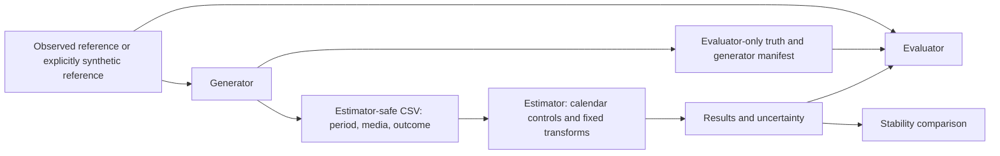

# Statistical contracts v0.2.1 — provenance patch over v0.2.0

Task 01B.1 extends generator/release provenance only; estimator/result contracts and
statistical rules remain v0.2.0. See [publication precision and admission](PUBLICATION_PRECISION.md).
Legacy full-date records and existing synthetic artifacts remain supported.

Status of the underlying statistical design: approved as merged in PR #2. Task 01a implements the synthetic Stage-A
subset; see [execution and measured limitations](RUN_SYNTHETIC_MMM.md). The normative
statistical calculations below are unchanged; successful execution does not establish empirical
coverage, power or real marketing ROI.
This replaces the baseline-as-regressor proposal in v0.1.0. Python is the runtime;
no R-parity gate is required. The estimator's job is to separate injected media from
an imperfectly explained baseline, not to regress on the baseline used to make y.

## 1. File boundaries and data flow

| Artifact | Allowed readers | Contents |
|---|---|---|
| Reference CSV + `generator.json` | generator, evaluator | Immutable monthly reference, full provenance/release ledger, generation settings and seed |
| Estimator CSV + `manifest.json` | estimator, evaluator | Exactly `period,synthetic_media,semi_synthetic_outcome`; no reference values/path, truth path, planted beta or generation effect/noise fractions |
| Truth JSON | evaluator only | Dataset identity, source/generator hashes, planted beta, transforms, noise scale, realized noiseless monthly contributions and response curve |
| Result JSON | evaluator, comparator, report | Estimated parameters/intervals, diagnostics, holdout contribution, model response; hashes bind the estimator manifest/data |
| Comparison JSON | report | Hashed results, common support/grid, signed changes and declared sensitivity flags; result references provide each run's uncertainty |
| Evaluation JSON | report, later simulation aggregation | Hashed result/truth, coefficient/contribution/curve recovery errors, interval coverage and detection outcomes |

The estimator manifest accepts neither observed reference fields nor truth
coefficients at any structured configuration position. Extra CSV columns are rejected.
Controls are derived from `period`; there is no arbitrary regressor/expression hook.
Oracle transform parameters are intentionally public in Stage A; planted media beta,
reference values, noise and confounding parameters are not.

Validators establish interface and artifact integrity, not operating-system isolation.
In Task 01 the estimator entry point must receive only the approved manifest and
CSV; run it in a directory/container without mounted private reference/truth files.
Do not auto-discover parent directories or pass generator configuration/environment
variables into it. Add a runtime isolation test when that entry point exists. The
current validation test succeeds after private reference/truth/config files are
removed and records that manifest validation reads only the estimator CSV.
Arbitrary text metadata is not a covert-channel defence against a malicious caller;
review provenance and keep the estimator entry point narrowly scoped.

## 2. DGP and controls

For a fixed reference B[t] and nonnegative synthetic spend x[t]:

- `a[t] = sum(alpha**lag * x[t-lag], lag=0..min(t,L))`, zero prehistory,
  `0 <= alpha < 1`, finite `0 <= L <= 12`, **normalize=False**.
- `H(a) = a**n / (k**n + a**n)`, `k > 0`, `n > 0`.
- `y[t] = B[t] + beta * H(a[t]) + epsilon[t]`.

B is never overwritten, rounded into y, rescaled to force recovery or exposed as a
regressor. y is continuous and may be negative; do not truncate it. Truth records
both realized noiseless contributions and the generating parameters, separately
from noise. Estimation is unconstrained OLS, so an estimated beta can be negative.

Use `numpy.linalg.lstsq(X_train, y_train, rcond=None)` for Stage-A OLS and
record the exact NumPy version. No constraints, fitted-target baseline or search.
Initial estimator design columns:

1. intercept;
2. linear integer month index, zero at training start;
3. `sin(2*pi*(calendar_month-1)/12)`;
4. `cos(2*pi*(calendar_month-1)/12)`;
5. quarter-end dummy for months 3, 6, 9, 12, if predeclared;
6. `H(adstock(x))`;
7. optional predeclared step dummies for documented breaks.

Each break has ID, start month, HTTPS evidence URL, evidence hash, publication date
and rationale. Evidence must exist by specification and before holdout; the break
must vary within training to be estimable. Duplicate IDs are rejected. The actual
source meaning/date requires human review: a checksum/declaration is not proof of
historical causation. No break is added after inspecting residuals, test error or
recovery. No Umweltbonus date is invented here. Default development runs use **no
break control**, deliberately retaining unmodelled disturbances.

Calendar controls are not proprietary data, observed target lags, fitted versions of
B or ground-truth components. Google Trends and other exogenous proxies are deferred
until their provenance, availability/publication lag and train-only preprocessing
are specified; they cannot be added as arbitrary CSV columns in v0.2.0.

Use HypoForge Python at audited commit
`c47f636d24a39a820574a13133d6af693134a180` for the reference transforms. Do not copy
upstream code. Reject missing/nonfinite exposure before its NA-to-zero behavior can
act. Carry training adstock history into holdout; never reset it at the boundary.
Stage A does not fit transform parameters. Manifest settings are archived before
fitting and stay fixed after observing results.

## 3. Stability outputs

### Coefficients and uncertainty

Result stores original-unit OLS estimates, standard errors and 95% intervals for
intercept, trend, Fourier terms, media and enabled controls. Disabled quarter-end is
`null`, not a spurious zero estimate. Break coefficient IDs must match the manifest.
All intervals contain their estimate and all numbers must be finite.

Stage A uncertainty is explicitly **conditional** on the fixed chosen controls and
transform parameters: Newey–West HAC, Bartlett kernel, predeclared max lag (proposed
initial value 3), covariance correction `N/(N-p)`, normal critical value
`1.959963984540054`. With training X and residual e, use lag-zero score outer products
plus symmetrized lag-l cross-products weighted `1-l/(max_lags+1)`, then sandwich by
`(X'X)^-1` on both sides. Do not claim this protects against omitted baseline bias,
nonlinear parameter selection, short-sample uncertainty or confounding. Stage C must
measure its empirical coverage. Nonpositive residual df or rank deficiency means
nonzero exit and no successful result artifact, not a fabricated zero SE.

### Contributions

Media contribution is `estimated_beta * H(a[t])`, evaluated using actual spend
history. Save one estimated contribution per **holdout month in chronological order**
and its sum, with an interval and explicit start/end/unit `count_equivalent`.
No EUR revenue, profit or real ROI interpretation follows. The fixed-transform total
has gradient `sum(H(a[t]))` with respect to beta; use its covariance-derived SE,
not independent-month error addition. The evaluator compares against the same
holdout slice of noiseless truth. CSV/raw reference hashes must stay unchanged.

### Common response curves

Grid x is **raw monthly synthetic spend**, units `synthetic_currency_per_month`.
Declare grid points before fitting, from the intersection of training min/max spend
ranges. Each run receives the identical serialized grid; no holdout-based range or
extrapolation. Require strictly increasing points and all points inside support.
The initial generator uses one shared dataset, so the support intersection is its
training range. Proposed grid construction: 21 equidistant inclusive points, reusing
that exact array for both results and truth. Empty/constant support is a failure.

History convention: spend held constant at x for at least `L+1` months, so
`a_ss(x) = x * sum(alpha**lag, lag=0..L)` and
`response(x) = beta * H(a_ss(x))`. Store estimates plus **pointwise**, not simultaneous,
95% bounds. For Stage A, H is fixed, giving SE `abs(H(a_ss))*SE(beta)`.
Truth uses the same convention/grid. The evaluator reports curve RMSE in
count-equivalent units. The comparator records the full right-minus-left curve
vector and its RMSE, contribution and holdout-RMSE deltas.

A stationary curve alone does not identify temporal alpha: evaluate realized
monthly contributions and holdout fit as well. Even curve identification can fail
when spend range is narrow or baseline/media are confounded. Do not treat k, n,
alpha and beta parameter agreement as interchangeable with response recovery.

### Diagnostics and instability

Compute design rank and condition number on training only. For condition diagnostics,
center/scale non-intercept columns using training sample SD (ddof=1), leaving the
intercept as ones; solve/report coefficients in original units. Zero-variance or
rank-deficient designs cannot claim success. `weak_identification` is set exactly
when scaled condition number reaches the **predeclared** manifest limit. The example
uses 1e8 as an engineering warning, not a calibrated scientific guarantee. A small
condition number does not establish causal identification.

A comparison requires distinct run IDs, identical data hashes, holdout, target and
grid. Let `d=max(abs(right_curve-left_curve))` and
`s=max(predeclared_scale_floor, max(abs(left_curve)), max(abs(right_curve)))`.
Record `relative_curve_change=d/s`; flag `unstable_results` when it reaches the
predeclared comparison limit. Report limit and floor; both are sensitivity-analysis
choices to be fixed before the comparison, not MDE thresholds. No universal numeric
stability limit is imposed by the schema. Per-run intervals remain in the referenced
results; do not invent an independent-samples interval for the difference between
fits on the same data. The example test limit is not an evidence-based recommendation.

## 4. Benchmark stages

| Stage | Question and protocol | Evaluation / restriction |
|---|---|---|
| A | Does the pipeline work and how does beta recover with fixed, known adstock/Hill? Fit the calendar baseline without B. Two runs can include versus omit quarter-end, keeping data/transforms/holdout identical. | Report beta error, curve RMSE, contribution error, conditional intervals, holdout error and diagnostics. No parameter search or power/MDE claim. v0.2.0 executable contracts are scoped to A. |
| B | Search transforms using training-only rolling-origin inner splits; include predeclared wrong transform families/parameters. | Freeze search bounds, budget, inner windows and selection criterion before fitting. Outer holdout untouched. Compare response/contribution recovery, not beta/k individually. Conditional Stage-A intervals are not selection-adjusted intervals. Extend the estimation/uncertainty protocol before implementation. |
| C | Replicated effect × noise × confounding × baseline × Stage-A/B specification experiment. | Scientific core: empirical recovery, interval coverage, detection and false positives with Monte Carlo uncertainty and failed-fit accounting. No repeated simulations are run by this PR. |

Illustrative C design, **not MDE thresholds**: effect fractions 0, 3%, 8%, 15%; noise
fractions 2%, 5%, 10%; independent media versus confounding concentrated on quarter
ends and baseline peaks at predeclared strengths. Repeat on Tesla and additional
baselines only after the same source/admission checks. Do not cherry-pick seeds or
select a calm brand because it yields desired recovery.

For every cell freeze source vintage, split, RNG streams/seeds, parameters, model
specification, intended replication count, failure rules and metric denominators.
Use common random numbers for paired specifications; do not stop sampling because
a result is favorable. Mean recovery errors use successful runs and report their
count; detection/coverage rates over all intended attempts count fit failures as
failures, with success-conditional rates reported separately if useful. Record
coefficient/contribution bias, absolute curve RMSE and any predeclared normalized
curve error. A **recovery rate** requires a declared accuracy tolerance and metric;
no universal tolerance is supplied here.

`media_interval_covers_truth` means planted beta lies in the interval (Stage A).
`positive_detection` means media interval lower bound > 0; `two_sided_rejection`
means the interval excludes 0 in either direction. Under the null effect, the latter
is the false-positive outcome. Reporting a positive detection is not a power claim.
Aggregate rates require binomial/Monte Carlo intervals (e.g. predeclared Wilson
intervals); replication count must support a declared precision, not just a large
looking count. B needs curve/contribution interval coverage and selection-adjusted
uncertainty, not beta equivalence under wrong parameterization.

### Detection-limit policy

Current comparison/evaluation schemas require `detection_limit_status=not_calibrated`
and `effect_below_detection_limit=null`. The flag is not in the accepted flag enums.
No numeric MDE or `effect_below_detection_limit=true/false` can be emitted by v0.2.0.

A future calibrated flag needs a separately reviewed Stage-C protocol/report with:

- explicit baseline vintage, window, model/search/uncertainty method, noise and
  confounding cell to which the conclusion applies;
- predeclared false-positive and coverage calibration requirements, power/detection
  target, recovery tolerance, error budget and Monte Carlo precision requirements;
- sufficient null and non-null replications, failed-fit accounting and interval
  estimates for the operating characteristics;
- an effect-grid threshold supported by those criteria, or `not_reached` /
  `not_calibrated` rather than extrapolating below the tested grid;
- an independently specified effect scale for the evaluated simulation. Real-world
  unknown effects cannot be flagged just by comparing a noisy beta estimate with a
  simulation threshold.

Only after calibration may an evaluator, never the estimator, identify a **known
simulated** effect below that conditional grid threshold and reference the immutable
calibration artifact. No single p-value, wide interval or small estimate suffices.
Target power, acceptable errors, replication precision and recovery tolerances are
open scientific decisions for Stage C, not hidden defaults in this PR.

## 5. Data availability and admission

Committed source evidence and the retained FZ 10 workbook were checked: SHA-256
`777366bf2a9c6ca4b0f62e5c106ea56dd7d61490b60f7377af041be81ca9332d`,
`Impressum` says January 2025 reporting period, February 2025 publication and monthly
frequency; Tesla brand total 1,277. Its dl-de/by-2-0 notice was audited in Task 00.
**At Task 00.5, verified coverage was one month only.** Current Task 01B.1 coverage
and independent admission regimes are documented in PUBLICATION_PRECISION.md. The archive selector's 2008–2025 range is
not a verified Tesla series. No 100-month or complete historical window is claimed.
See `SOURCE_CATALOG.md` and `source-evidence.json`; no new KBA time series is imported.

For `purpose=development_benchmark`, both input interfaces require:

- >=48 training months, >=12 contiguous holdout months and >=20 training residual
  degrees of freedom for the declared model; these are engineering admission floors
  (four training annual cycles, one holdout year), not statistical power guarantees;
- complete sorted unique months, finite nonnegative reference counts and exposures,
  no missing values, interpolation, silent row deletion or implicit zero filling;
- immutable reference and analysis hashes, declared coverage/vintage, per-column
  lineage and class; generator and estimator month indices aligned exactly;
- for observed KBA reference: one release record per admitted month, primary URL,
  release version, raw SHA-256, license identifier/URL and explicit rights verification.
  v0.2.1 records publication precision as day/month/unknown, distinct retrieval and
  nullable exact-vintage availability evidence. Retrospective immutable-reference
  admission permits missing publication days; historical point-in-time admission
  requires vintage-bound availability evidence by an explicit as-of cutoff. Legacy
  v0.2.0 full-date records remain accepted without implying historical availability.
  Derived CSV and raw source hashes remain separate. See PUBLICATION_PRECISION.md.

Metadata assertions do not verify every publisher fact: a human must admit actual
releases/extraction and resolve revisions. Do not silently mix corrected vintages.
No observed reference may be relabeled synthetic to bypass a data/rights blocker.
`contract_fixture` bypasses length floors only and is barred by `--require-benchmark`;
it still passes the same security, numeric, lineage and temporal checks. Task 01 must
use the benchmark gate for model runs and must never report fixture checks as recovery.

### Explicit synthetic development reference (fallback)

At Task 00.5 no suitable real Tesla series was admitted. Task 01B.1 now admits
verified KBA references retrospectively; historical as-of use remains blocked. The following **proposed
synthetic-only** protocol specifies a reproducible development path for Stage A;
it is not observed Tesla data or a model of actual Tesla sales.

- 72 months, 2018-01 through 2023-12; t=0..71.
- `B[t]=round(2000+15*t+250*sin(2*pi*t/12)+300*quarter_end[t]
  +600*I(t>=36)+900*I(t==50))` in fictional integer count units (nearest integer, ties to even); positive throughout.
  Freeze that reference CSV/hash before injecting media. Save its formula/version
  as lineage `synthetic_development_reference_v1`.
- Train 2018-01..2022-12 (60), holdout 2023-01..2023-12 (12).
- `SeedSequence(42).spawn(2)` -> independent NumPy PCG64 streams for media and noise;
  save exact NumPy and generator implementation versions and final file hashes.
- Media `x[t]=100*exp(.3*z[t]+lambda*qz[t]+lambda*bz[t])`, z iid standard normal;
  qz and bz use **training** mean/sample SD of quarter-end and B, applied unchanged
  to holdout. Fail on zero SD when confounding is requested. Independent mode lambda=0;
  confounded mode lambda>0 uses both quarterly and baseline-peak concentration.
- Initial Stage A proposal: alpha=.5, L=3, k=100, n=1.5, effect fraction .08,
  noise fraction .05, independent media. Define
  `beta=effect_fraction*mean(B_train)/mean(H(a_train))` and
  `noise_sd=noise_fraction*mean(B_train)`. Fail on zero response mean. Draw epsilon
  from the separate noise stream. Both fractions are simulation design inputs,
  not recovered effects, priors or MDE thresholds.
- Both fits use oracle transforms, Fourier order 1 and linear trend, no break
  controls; one includes quarter-end and the other deliberately omits it. The planted
  level shift and outlier are not handed to the estimator. Preserve them as documented
  baseline difficulty. Share the same grid/data/holdout, report differences honestly.

Task 01 will implement this generator and its determinism/isolation tests if this
proposal is approved. No generator/model is implemented here. Existing six-row CSVs
are hand-authored **shape examples**, not output of this protocol or a benchmark.
Tests create private temporary shape graphs; their coefficients/truth are fabricated
for validation only and are never published as fitted statistical results.

## 6. Remaining decisions and scope

Stage A's interfaces, DGP development proposal, controls, fixed-transform estimator,
uncertainty definition and file checks are specified for review. Before first model
execution: human approval of Task 00.5/Task 01, freeze the chosen synthetic or admitted
real-data protocol, diagnostic/stability choices and implementation dependency versions.
Real Tesla experiments additionally need a verified adequate monthly series; a
positive source-ledger declaration alone does not resolve that blocker.

Stage-B search bounds/rolling protocol/selection uncertainty and Stage-C recovery
accuracy, power/error targets and replication precision remain scientific decisions.
They do not justify silently broadening Task 01. Bayesian priors and simulated
geo-test calibration are later extensions, not included in these schemas.

The Task 01 work order is aligned as a plan only; implementation still needs explicit
approval. No MMM engine, UI, MCP server, production generator, external publication or reference
repository changes are part of Task 00.5. File validators recompute arithmetic summaries
and verify identity/support only; they do not estimate, prove confidence coverage,
reconstruct source history, validate a DGP scientifically or enforce process isolation.

## Task 00.5 verification evidence

Local checks executed in a fresh `/tmp/task005-ci-venv` (Python 3.12.14,
`jsonschema==4.26.0`, only its normal dependency installation):

- `python3 contracts/validate.py`: estimator-safe manifest and six-row CSV valid.
- `python3 contracts/validate.py contracts/examples/generator.json --kind generator`:
  separate generator manifest/reference fixture valid.
- `python3 -m unittest discover -s tests -v`: **49 tests passed**; the prior 30 tests
  were migrated without dropping their safety/provenance guarantees, with reference
  count checks moved to the private generator interface, plus 19 statistical-contract
  tests. Shared regex definitions and all local references are checked offline.
- `git diff --check`: passed.

No DGP, fit, recovery performance or empirical confidence coverage was computed.
Actual remote Actions status is linked in the Draft PR for its precise commit; local
results do not establish remote CI. No WKR/HypoForge/Kinderwelt code was changed or
rerun as part of this design task.
