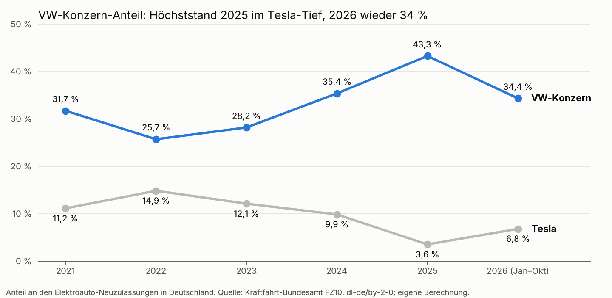

# Management Summary für Volkswagen: Was treibt den Elektroauto-Markt in Deutschland?

Stand 7. November 2026 · Datenbasis: KBA-Neuzulassungen Januar 2021 – Oktober 2026

## Kernaussagen

Der VW-Konzern ist mit 34 % der Elektroauto-Neuzulassungen (Jan–Okt 2026) klarer Marktführer in Deutschland, hat aber 9 Prozentpunkte gegenüber 2025 abgegeben, weil Tesla zurückgekommen ist. Die Analyse von 69 Monaten KBA-Daten zeigt: Förderprogramme bewegen vor allem den Gesamtmarkt, nicht den VW-Anteil; Benzinpreise und die 2026er-Prämie zeigen keinen belastbaren Zusammenhang.

- **Marktposition:** 239.980 Elektroautos des VW-Konzerns von Januar bis Oktober 2026, schon mehr als im ganzen Jahr 2025 (236.032). Der Anteil fiel aber von 43,3 % (2025) auf 34,4 %.
- **Förderung 2021–2023:** ging mit einem um rund 55 % höheren Gesamtmarkt einher. Der VW-Anteil relativ zum Rest war in der Innovationsprämie dagegen niedriger als in der prämienfreien Zeit 2024/25 (rund −23 %).
- **Förderung 2026 und Steuerpaket Juli 2025:** kein belastbarer Zusammenhang, weder mit dem Gesamtmarkt noch mit dem VW-Anteil.
- **Benzinpreis:** höhere Spritpreise gehen tendenziell mit mehr Elektroautos im Folgemonat einher, aber nicht statistisch gesichert. Beim VW-Anteil zeigt sich eher ein leichter Rückgang zugunsten kleinerer Marken.
- **Tesla-Rhythmus:** Tesla liefert in Quartalsendmonaten gebündelt aus; in diesen Monaten liegt der VW-Anteil leicht niedriger. Im Oktober 2026 kam der VW-Konzern auf 34,4 %, Tesla nur auf 3,1 %.

Alle Ergebnisse sind statistische Zusammenhänge, keine nachgewiesenen Ursachen.

## Marktlage 2021–2026

VW-Konzern und Tesla bewegen sich gegenläufig: Der höchste VW-Anteil fiel in Teslas schwächstes Jahr, Teslas Erholung 2026 kostete VW 9 Prozentpunkte. Der Markt selbst wuchs 2026 auf bereits 698.230 Elektroautos bis Oktober.

## Förderprogramme

Kaufprämien hoben den gesamten Elektroauto-Markt, aber nicht den VW-Anteil. Vergleichsbasis ist jeweils die prämienfreie Zeit Januar 2024 bis Juni 2025.

| Programm | Gültig | Gesamtmarkt | VW-Konzern relativ zum Rest |
| --- | --- | --- | --- |
| Innovationsprämie (doppelter Bundesanteil) | bis 31.12.2022 | +55 %, gesichert | −23 %, gesichert |
| Umweltbonus reduziert, alle Käufer | Jan–Aug 2023 | +58 %, gesichert | −17 %, nicht gesichert |
| Umweltbonus nur Privatkunden | Sep–17.12.2023 | +53 %, gesichert | −13 %, nicht gesichert |
| Vorziehmonat vor Kürzung | Dez 2022 | +136 %, gesichert | −4 %, nicht gesichert |
| Vorziehmonat vor Ende Gewerbeförderung | Aug 2023 | +115 %, gesichert | −31 %, nicht gesichert |
| Steuerpaket (Dienstwagen bis 100.000 €, 75 % Sonderabschreibung) | ab 01.07.2025 | +22 %, nicht gesichert | −8 %, nicht gesichert |
| E-Auto-Förderung 2026 (einkommensabhängig) | ab 01.01.2026 | −7 %, nicht gesichert | +5 %, nicht gesichert |

Werte gelten für den jeweiligen Monat; weil der Markt träge ist, wirkt ein dauerhaftes Programm über die Folgemonate stärker. „Gesichert“ heißt: 95-%-Intervall schließt null aus.

Für VW bedeutet das: Die Prämienjahre haben vor allem den Markt vergrößert, wovon Wettbewerber relativ stärker profitierten. Die stärkste VW-Position (43 % in 2025) fiel in eine prämienfreie Phase, allerdings auch in Teslas Schwächejahr. Das Ende des Umweltbonus und die 70.000-€-Dienstwagengrenze (Januar 2024) lassen sich statistisch nicht trennen.

## Benzinpreis

Höhere Benzinpreise gehen tendenziell mit mehr Elektroauto-Zulassungen einher, statistisch gesichert ist das nicht. Der Effekt kommt im Folgemonat: 10 % höhere Preise für Super 95 gehen mit rund +10 % Elektroautos einher (95-%-Intervall −1 % bis +22 %).

- **Verzögerung:** Mit 1 bis 4 Monaten Verzögerung bleibt das Bild gleich; fast die ganze Wirkung liegt im ersten Monat.
- **Zeittrend:** Die Benzinpreis-Empfindlichkeit des Marktes steigt tendenziell von etwa null (2021) auf +0,8 (2026), aber nicht gesichert.
- **VW-Anteil:** Nach einem Benzinpreisanstieg sinkt der Anteil des VW-Konzerns relativ zum Rest tendenziell (kumuliert −0,29 Log-Punkte, Intervall −0,93 bis +0,08). Auch Tesla, BMW, Mercedes und Hyundai-Kia verlieren leicht; rechnerisch gewinnen die übrigen, oft günstigeren Marken. In einer von fünf Modellvarianten ist der VW-Rückgang gesichert.
- **Kein Zeittrend beim VW-Anteil:** Anders als beim Gesamtmarkt ändert sich die Benzinpreis-Wirkung auf den VW-Anteil über die Jahre nicht (Steigung −0,01 pro Jahr).

Benzinpreis-Spitzen 2022 und 2026 fielen mit Förderänderungen zusammen, was die Trennung erschwert.

## Wettbewerb mit Tesla und Prognosegüte

Teslas Zulassungen schwanken stark im Quartalsrhythmus, und das verschiebt die Monatsanteile von VW spürbar. Im September 2026 kam Tesla auf 12.552 Elektroautos (14,2 %), im Oktober nur auf 2.932 (3,1 %); der VW-Konzern lag bei 30,4 % bzw. 34,4 %.

- **Quartalsende:** In März, Juni, September und Dezember liegt Teslas Anteil relativ zum Rest rund doppelt so hoch wie sonst (+0,71 Log-Punkte, gesichert). Der VW-Anteil ist in diesen Monaten leicht niedriger (−0,09, knapp nicht gesichert).
- **Lesehilfe für Monatszahlen:** VW-Anteile in Quartalsendmonaten sollten mit dem Vorjahresmonat oder dem Quartal verglichen werden, nicht mit dem Vormonat.
- **Teslas Zyklus:** 2025 fiel Tesla auf 3,6 % Anteil (−48 % Zulassungen bei +43 % Markt); 2026 erholt es sich auf 6,8 % (Jan–Okt). Der VW-Konzern hatte seinen höchsten Anteil im Tesla-Tiefjahr.
- **Prognosegüte für den VW-Konzern:** Einen Monat voraus liegt der mittlere Fehler bei rund 4.000 bis 4.600 Fahrzeugen, gut ein Fünftel eines Durchschnittsmonats (rund 20.000–23.000). Für Oktober 2026 sagte das Modell 24.504 voraus, tatsächlich waren es 32.394. Das reicht für Trendaussagen, nicht für Monatsplanung.

## Implikationen für Volkswagen und Grenzen

Für die Planung heißt das: Der VW-Anteil hängt stärker an der Wettbewerbslage, vor allem an Tesla, als an Förderung oder Spritpreis.

1. **Förderung als Marktgröße, nicht als Anteilshebel planen.** Prämien vergrößerten den Markt; der VW-Anteil stieg dabei nicht mit.
2. **Die 2026er-Prämie nicht als Absatztreiber einplanen.** Bisher ist kein Zusammenhang mit dem Markt messbar; nach zehn Monaten Laufzeit ist das aber noch früh.
3. **Tesla-Wellen in Monatsberichten herausrechnen.** Quartalsendmonate verzerren den VW-Anteil nach unten.
4. **Spritpreise beobachten, nicht steuern.** Der Zusammenhang ist schwach und eher marktweit; vom Effekt profitieren tendenziell günstigere Wettbewerber.

**Grenzen der Analyse**

- 69 Monate Daten; viele Effekte bleiben deshalb statistisch offen.
- Alle Ergebnisse sind Zusammenhänge, keine nachgewiesenen Ursachen. Förderänderungen fielen mit der Energiekrise 2022, Modellwechseln und Teslas Einbruch 2025 zusammen.
- Markenpreise fehlen: Es gibt keine öffentlichen Durchschnittspreise je Marke. Ein Listenpreisindex (Preis pro 100 km Reichweite) ist vorgeschlagen, aber nicht gebaut.
- Chinesische Marken stehen beim KBA oft nur im Sammelposten „Sonstige“ und sind deshalb im Rest enthalten.
- „VW-Konzern“ = VW, Audi, Skoda, Seat/Cupra, Porsche; ohne Nutzfahrzeuge.

## Quellen

- [Kraftfahrt-Bundesamt, FZ10 Neuzulassungen nach Marken und Modellreihen](https://www.kba.de/DE/Statistik/Fahrzeuge/Neuzulassungen/MonatlicheNeuzulassungen/monatl_neuzulassungen_node.html), Januar 2021 – Oktober 2026 (dl-de/by-2-0); Datenstand im Repo: [`data/competition_vintage_2026_11/`](../../data/competition_vintage_2026_11/README.md)
- [EU Weekly Oil Bulletin](https://energy.ec.europa.eu/data-and-analysis/weekly-oil-bulletin_en), Super 95 und Diesel Deutschland: [`data/fuel_prices_de/`](../../data/fuel_prices_de/README.md)
- Eurostat HICP `prc_hicp_minr`, Strom und Neuwagen Deutschland: [`data/hicp_de/`](../../data/hicp_de/README.md)
- Förderprogramme: [`data/policy_regimes_de/`](../../data/policy_regimes_de/README.md) ([Umweltbonus – Wikipedia](https://de.wikipedia.org/w/index.php?title=Umweltbonus&oldid=270724749), [§ 6 EStG](https://www.gesetze-im-internet.de/estg/__6.html), [§ 7 EStG](https://www.gesetze-im-internet.de/estg/__7.html))
- Modellergebnisse (Bayes-VAR, 69 Monate, Protokolle vor der Schätzung festgeschrieben): [Hauptmodell](../../results/multibrand/README.md), [Benzinpreis-Lags](../../results/multibrand_fuel_lags/README.md), [zeitvariabler Benzinpreis-Koeffizient](../../results/multibrand_fuel_tv_trend/README.md)

Grafik: `python -m scripts.vw_summary_figure`. Die Zahlen dieses Dokuments werden durch `tests/test_vw_management_summary.py` gegen die Daten und Modellergebnisse geprüft.
