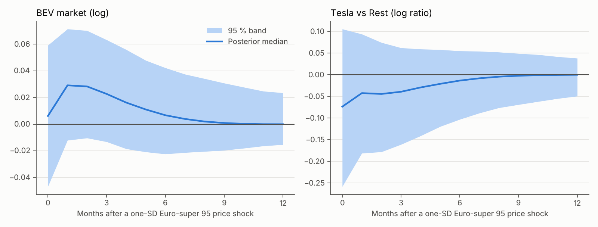
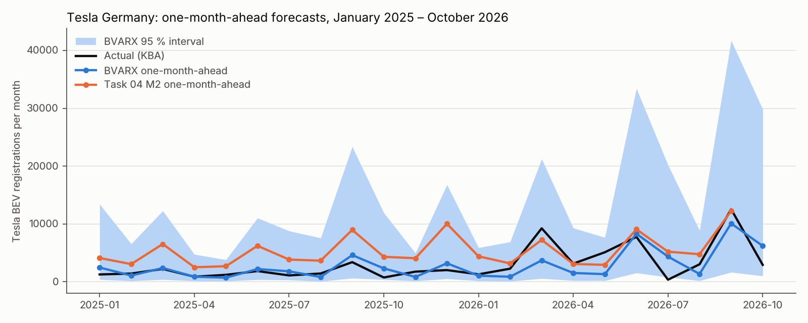

# Multi-brand BVARX: results (protocol `multibrand-bvarx/1.0.0`)

Generated by `python -m scripts.multibrand_report` from the CSV files in this folder; no number below is typed by hand. Protocol: [docs/MULTIBRAND_BVAR_PROTOCOL.md](../../docs/MULTIBRAND_BVAR_PROTOCOL.md), SHA-256 `e33dd45d93e29a0c…`, 4,000 posterior draws, seed 20261107.

**Model.** Bayesian VARX(1) with a Minnesota prior on 69 months (2021-01 – 2026-09). Endogenous: Euro-super 95 price, BEV market, and the log ratios of Tesla, VW Group, BMW Group, Mercedes and Hyundai-Kia to the rest of the BEV market. Exogenous: calendar, quarter-end, seven incentive indicators, HICP electricity and HICP new cars. All coefficients are **conditional associations**, not causal effects; † = 95 % posterior interval excludes zero.

## 1. Verdicts

| Hypothesis | Primary | λ = 0.1 | λ = 0.5 | No prices | Fuel calendar-day (2022-05+) |
|---|---|---|---|---|---|
| H-F market | open | open | supported | open | open |
| H-F Tesla share | open | open | open | open | open |
| H-P2026 | open | open | open | open | open |
| H-Tax | open | open | open | open | open |
| Forecast gain Tesla vs M2 | open (2/4) | open (2/4) | open (2/4) | open (2/4) | – |
| Forecast gain BEV_market vs M2 | weakened (0/4) | open (1/4) | weakened (0/4) | weakened (0/4) | – |

Rules (frozen): *supported* / *weakened* when the 95 % interval lies entirely above / below zero (forecast: BVARX beats Task 04 M2 in all / none of 2025 h=1, 2025 h=3, 2026 h=1, 2026 h=3); otherwise *open*.

## 2. Incentive programmes (primary model)

Differences to the baseline January 2024 – June 2025 (no purchase grant, company-car cap 70k EUR). Market column in log points; the brand columns change the log ratio to Rest.

| Programme | BEV market | Tesla/Rest | VW Group/Rest | BMW Group/Rest | Mercedes/Rest | Hyundai-Kia/Rest |
|---|---|---|---|---|---|---|
| `innovation_premium` | +0.44 [+0.17; +0.71] **†** | -0.54 [-1.49; +0.40] | -0.26 [-0.48; -0.05] **†** | -0.40 [-0.67; -0.12] **†** | -0.62 [-0.93; -0.33] **†** | -0.17 [-0.38; +0.03] |
| `grant_2023_all` | +0.46 [+0.11; +0.79] **†** | +0.12 [-1.04; +1.34] | -0.19 [-0.46; +0.07] | -0.14 [-0.48; +0.19] | -0.46 [-0.84; -0.08] **†** | -0.19 [-0.43; +0.06] |
| `grant_2023_private` | +0.43 [+0.07; +0.79] **†** | -0.69 [-1.97; +0.60] | -0.14 [-0.43; +0.14] | +0.17 [-0.19; +0.53] | -0.50 [-0.89; -0.09] **†** | -0.23 [-0.50; +0.04] |
| `pre_cut_2022_12` | +0.86 [+0.35; +1.38] **†** | -0.46 [-2.29; +1.40] | -0.05 [-0.45; +0.37] | +0.29 [-0.24; +0.79] | -0.34 [-0.91; +0.26] | +0.13 [-0.25; +0.52] |
| `pre_business_end_2023_08` | +0.77 [+0.27; +1.27] **†** | -0.69 [-2.39; +1.02] | -0.37 [-0.76; +0.04] | -0.33 [-0.81; +0.16] | -0.81 [-1.33; -0.25] **†** | +0.06 [-0.31; +0.41] |
| `tax_package_2025_07` | +0.20 [-0.05; +0.44] | -0.78 [-1.60; +0.03] | -0.08 [-0.27; +0.10] | -0.00 [-0.24; +0.23] | -0.13 [-0.39; +0.13] | -0.14 [-0.32; +0.03] |
| `grant_2026` | -0.07 [-0.41; +0.27] | +1.00 [-0.21; +2.19] | +0.05 [-0.22; +0.32] | -0.18 [-0.51; +0.18] | +0.24 [-0.14; +0.63] | +0.23 [-0.03; +0.49] |

For reading the market column: `innovation_premium` +0.44 ≈ +55 %; `grant_2023_all` +0.46 ≈ +58 %; `grant_2023_private` +0.43 ≈ +53 %; `pre_cut_2022_12` +0.86 ≈ +136 %; `pre_business_end_2023_08` +0.77 ≈ +115 %; `tax_package_2025_07` +0.20 ≈ +22 %; `grant_2026` -0.07 ≈ -7 %.
These are same-month coefficients. The market equation also carries its own lag (posterior median +0.35), so a programme that stays in force accumulates further over subsequent months; pulses (`pre_*`) are one-month pull-forward spikes.

## 3. Prices and quarter-end (primary model)

| Term | BEV market | Tesla/Rest | VW Group/Rest | BMW Group/Rest | Mercedes/Rest | Hyundai-Kia/Rest | Fuel price |
|---|---|---|---|---|---|---|---|
| `log_electricity` | -2.38 [-4.26; -0.44] **†** | +2.67 [-4.29; +9.44] | +0.57 [-0.92; +2.17] | -0.45 [-2.36; +1.47] | +2.71 [+0.51; +4.85] **†** | +0.80 [-0.66; +2.23] | +0.26 [-0.05; +0.55] |
| `log_new_cars` | +3.83 [+1.62; +6.07] **†** | -1.71 [-9.39; +6.23] | -0.61 [-2.42; +1.14] | +0.57 [-1.71; +2.81] | -3.45 [-5.92; -0.85] **†** | -0.72 [-2.40; +0.98] | -0.27 [-0.62; +0.07] |
| `quarter_end` | +0.19 [+0.07; +0.30] **†** | +0.71 [+0.30; +1.12] **†** | -0.09 [-0.18; +0.01] | -0.08 [-0.20; +0.04] | -0.19 [-0.32; -0.06] **†** | -0.12 [-0.20; -0.03] **†** | +0.00 [-0.02; +0.02] |

Price coefficients are elasticities with respect to the index level. Both HICP series trend over the window together with BEV adoption, so their signs partly absorb trends; they are controls, not demand elasticities.

## 4. Fuel price shock (fuel ordered first)

One posterior-median standard deviation of the fuel innovation is 3.3 % of the Euro-super 95 price. Cumulative response over months 0–11 (sum of log responses):

| Specification | BEV market | Tesla/Rest | VW Group/Rest | BMW Group/Rest | Mercedes/Rest | Hyundai-Kia/Rest |
|---|---|---|---|---|---|---|
| primary | +0.13 [-0.15; +0.47] | -0.28 [-1.19; +0.45] | -0.29 [-0.93; +0.08] | -0.07 [-0.50; +0.38] | -0.05 [-0.45; +0.31] | -0.15 [-0.46; +0.06] |
| lambda_0.1 | +0.08 [-0.44; +0.67] | -0.38 [-2.10; +1.04] | -0.23 [-0.86; +0.23] | -0.04 [-0.63; +0.54] | -0.09 [-0.73; +0.50] | -0.16 [-0.60; +0.18] |
| lambda_0.5 | +0.15 [+0.02; +0.42] **†** | -0.25 [-0.85; +0.19] | -0.32 [-0.95; -0.02] **†** | -0.09 [-0.46; +0.20] | -0.02 [-0.26; +0.21] | -0.13 [-0.39; +0.01] |
| no_prices | +0.15 [-0.15; +0.52] | -0.05 [-0.84; +0.78] | -0.25 [-0.73; +0.13] | -0.17 [-0.61; +0.16] | +0.21 [-0.13; +0.70] | -0.13 [-0.37; +0.09] |
| fuel_calendar_day | +0.07 [-0.36; +0.60] | +0.20 [-0.67; +1.47] | -0.19 [-0.85; +0.27] | -0.08 [-0.83; +0.45] | -0.13 [-0.71; +0.29] | -0.12 [-0.56; +0.16] |



## 5. Forecasts against Task 04 (identical target months)

RMSE in registrations per month (lower is better). 2026 = January–September; October 2026 has no Task 04 comparator.

**Tesla**

| Model | 2025 h=1 | 2025 h=3 | 2026 h=1 | 2026 h=3 | Oct 2026 h=1 | Oct 2026 h=3 |
|---|---|---|---|---|---|---|
| primary | 866 | 1,068 | 2,880 | 3,578 | 3,268 | 510 |
| lambda_0.1 | 978 | 770 | 3,376 | 3,506 | 5,441 | 1,184 |
| lambda_0.5 | 1,011 | 1,559 | 2,708 | 3,521 | 2,488 | 997 |
| no_prices | 897 | 1,023 | 2,885 | 3,550 | 3,770 | 1,312 |
| M2 | 3,863 | 4,315 | 2,299 | 2,213 | – | – |
| M0 | 4,293 | 4,730 | 2,071 | 2,070 | – | – |
| seasonal_naive | 1,906 | 1,372 | 4,620 | 4,620 | 2,182 | 2,182 |

**BEV market**

| Model | 2025 h=1 | 2025 h=3 | 2026 h=1 | 2026 h=3 | Oct 2026 h=1 | Oct 2026 h=3 |
|---|---|---|---|---|---|---|
| primary | 8,133 | 10,595 | 8,972 | 11,129 | 12,693 | 24,215 |
| lambda_0.1 | 6,953 | 9,340 | 9,087 | 10,971 | 15,696 | 24,051 |
| lambda_0.5 | 9,863 | 11,387 | 9,610 | 11,095 | 7,827 | 25,130 |
| no_prices | 8,207 | 12,344 | 9,655 | 11,605 | 19,073 | 26,307 |
| M2 | 7,840 | 8,970 | 8,715 | 9,905 | – | – |
| M0 | 7,417 | 8,289 | 15,706 | 17,625 | – | – |
| seasonal_naive | 14,540 | 15,233 | 27,077 | 27,077 | 41,661 | 41,661 |

October 2026, Tesla: actual 2,932; BVARX one month ahead 6,200 [1,013; 29,848], three months ahead 3,442 [402; 23,137].



## 6. Limits

- 69 months, 7 equations, 21 regressors per equation: the prior matters (see λ sensitivities).
- Incentives coincide with the 2022 energy shock, model launches and Tesla's 2025 share loss; the end of the Umweltbonus and the 70k company-car cap cannot be separated.
- Chinese brands are partly hidden in KBA `SONSTIGE` and stay in Rest.
- No brand-level prices exist; HICP new cars is a market-wide index.
- Fuel is endogenous by request; only the fuel shock is identified (recursive ordering).
- HICP after the forecast origin is held at its last value; incentives enter only once announced.

## Files

`coefficients.csv` (all terms incl. lags, all specifications), `irf_fuel_shock.csv`, `predictions.csv` (BVARX and comparators), `metrics.csv`, `hypotheses.csv`, `manifest.json` (input/code/output hashes, versions). Reproduce:

```sh
python -m multibrand.study
python -m scripts.multibrand_figures
python -m scripts.multibrand_report
```
