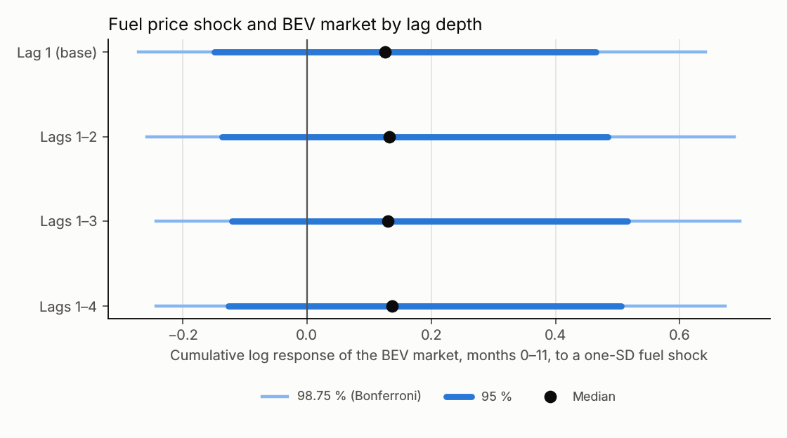

# Fuel price at lags 1–4 (amendment `multibrand-bvarx/1.1.0-fuel-lags`)

Generated by `python -m scripts.multibrand_fuel_lags_report` from the CSVs in this folder. [Amendment](../../docs/MULTIBRAND_FUEL_LAGS_PROTOCOL.md) frozen before fitting (SHA-256 `035768d7b037037b…`); 4,000 draws per variant, identical outcome months 2021-02..2026-09. Variant L adds Euro-super 95 at lags 2…L to every equation of the [base model](../multibrand/README.md); L = 1 is the base model. Intervals: 95 % in brackets, Bonferroni 98.75 % in parentheses. Associations, not causal effects.

## 1. Direct fuel-lag coefficients (elasticities, log points per log point of fuel)

| L | BEV market: lag 1 | lag 2 | lag 3 | lag 4 | **sum of lags** |
|---|---|---|---|---|---|
| 1 | +0.95 [-0.11; +1.99] | – | – | – | +0.95 [-0.11; +1.99] (-0.39; +2.34) |
| 2 | +0.81 [-0.28; +1.94] | +0.22 [-0.60; +1.04] | – | – | +1.03 [-0.04; +2.16] (-0.33; +2.50) |
| 3 | +0.84 [-0.33; +1.92] | +0.23 [-0.55; +1.05] | -0.03 [-0.62; +0.56] | – | +1.03 [-0.14; +2.14] (-0.46; +2.43) |
| 4 | +0.81 [-0.31; +1.96] | +0.22 [-0.60; +1.05] | -0.03 [-0.62; +0.58] | +0.05 [-0.39; +0.53] | +1.07 [-0.15; +2.22] (-0.43; +2.56) |

| L | Tesla/Rest: lag 1 | lag 2 | lag 3 | lag 4 | **sum of lags** |
|---|---|---|---|---|---|
| 1 | -0.77 [-4.38; +2.83] | – | – | – | -0.77 [-4.38; +2.83] (-5.24; +3.83) |
| 2 | -0.28 [-4.18; +3.70] | -1.07 [-3.88; +1.78] | – | – | -1.29 [-5.11; +2.67] (-6.30; +3.81) |
| 3 | -0.25 [-4.17; +3.79] | -1.05 [-3.95; +1.81] | -0.13 [-2.13; +1.90] | – | -1.45 [-5.49; +2.47] (-6.74; +3.76) |
| 4 | -0.22 [-4.35; +3.69] | -1.05 [-3.96; +1.79] | -0.13 [-2.16; +1.93] | +0.22 [-1.32; +1.88] | -1.21 [-5.17; +2.91] (-6.14; +4.05) |

Reading: in the base model a 10 % higher fuel price goes with a +9.9 % BEV market in the following month (95 % interval -1.1 % to +22.0 %).

## 2. Cumulative response to a one-SD fuel shock (months 0–11)

| L | BEV market | Tesla/Rest | VW Group/Rest | BMW Group/Rest | Mercedes/Rest | Hyundai-Kia/Rest |
|---|---|---|---|---|---|---|
| 1 | +0.13 [-0.15; +0.47] (-0.27; +0.64) | -0.28 [-1.19; +0.45] (-1.63; +0.77) | -0.29 [-0.93; +0.08] (-1.22; +0.23) | -0.07 [-0.50; +0.38] (-0.73; +0.56) | -0.05 [-0.45; +0.31] (-0.62; +0.49) | -0.15 [-0.46; +0.06] (-0.57; +0.14) |
| 2 | +0.13 [-0.14; +0.48] (-0.26; +0.69) | -0.34 [-1.32; +0.36] (-1.93; +0.63) | -0.25 [-0.86; +0.14] (-1.16; +0.26) | -0.06 [-0.50; +0.37] (-0.71; +0.57) | -0.07 [-0.48; +0.29] (-0.70; +0.46) | -0.15 [-0.45; +0.05] (-0.63; +0.14) |
| 3 | +0.13 [-0.12; +0.52] (-0.24; +0.70) | -0.37 [-1.30; +0.36] (-1.78; +0.62) | -0.26 [-0.87; +0.13] (-1.15; +0.28) | -0.04 [-0.47; +0.38] (-0.71; +0.61) | -0.06 [-0.47; +0.32] (-0.66; +0.51) | -0.15 [-0.47; +0.08] (-0.63; +0.17) |
| 4 | +0.14 [-0.13; +0.51] (-0.24; +0.67) | -0.36 [-1.38; +0.39] (-1.95; +0.69) | -0.29 [-0.88; +0.12] (-1.22; +0.30) | -0.03 [-0.46; +0.41] (-0.62; +0.62) | -0.07 [-0.48; +0.32] (-0.62; +0.48) | -0.15 [-0.46; +0.07] (-0.59; +0.19) |



## 3. Verdicts

| L | H-F market | H-F Tesla share |
|---|---|---|
| 1 | open | open |
| 2 | open | open |
| 3 | open | open |
| 4 | open | open |
| all | not robust to lag choice | not robust to lag choice |

## 4. Lag depth: log marginal likelihood

| L | Regressors per equation | log marginal likelihood | difference to best |
|---|---|---|---|
| 1 | 21 | -362.19 | +0.00 |
| 2 | 22 | -362.44 | -0.24 |
| 3 | 23 | -362.78 | -0.59 |
| 4 | 24 | -362.54 | -0.34 |

Differences below about 1 log unit (Bayes factor < e ≈ 2.7) are conventionally not worth more than a bare mention; they also depend on the prior.

## 5. Forecast RMSE (registrations per month)

**Tesla**

| Model | 2025 h=1 | 2025 h=3 | 2026 h=1 | 2026 h=3 | Oct 2026 h=1 | Oct 2026 h=3 |
|---|---|---|---|---|---|---|
| L1 | 866 | 1,068 | 2,880 | 3,578 | 3,268 | 510 |
| L2 | 886 | 1,137 | 2,978 | 3,613 | 3,299 | 637 |
| L3 | 899 | 1,114 | 2,955 | 3,585 | 2,998 | 788 |
| L4 | 866 | 1,101 | 2,989 | 3,631 | 2,933 | 659 |
| M2 | 3,863 | 4,315 | 2,299 | 2,213 | – | – |

**BEV market**

| Model | 2025 h=1 | 2025 h=3 | 2026 h=1 | 2026 h=3 | Oct 2026 h=1 | Oct 2026 h=3 |
|---|---|---|---|---|---|---|
| L1 | 8,133 | 10,595 | 8,972 | 11,129 | 12,693 | 24,215 |
| L2 | 8,436 | 10,771 | 8,886 | 11,049 | 11,409 | 23,461 |
| L3 | 8,222 | 10,664 | 8,689 | 11,027 | 12,130 | 23,483 |
| L4 | 8,232 | 10,690 | 8,825 | 10,486 | 11,839 | 24,266 |
| M2 | 7,840 | 8,970 | 8,715 | 9,905 | – | – |

## Files

`lag_coefficients.csv`, `irf_cumulative.csv`, `marginal_likelihood.csv`, `predictions.csv`, `metrics.csv`, `hypotheses.csv`, `manifest.json`. Reproduce:

```sh
python -m multibrand.fuel_lags
python -m scripts.multibrand_fuel_lags_report
```
