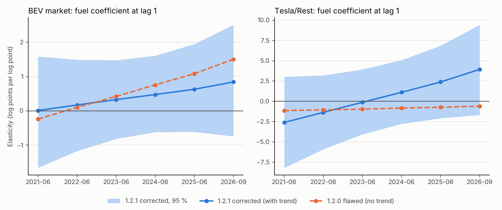

# Time-varying fuel coefficient at lag 1 — corrected amendment 1.2.1

Generated by `python -m scripts.multibrand_fuel_tv_report` from the CSVs in this folder. [Amendment](../../docs/MULTIBRAND_FUEL_TV_TREND_PROTOCOL.md) frozen before fitting (SHA-256 `1842323cb5f40152…`), 4,000 draws, outcome months 2021-02..2026-09. Every equation gets a linear trend τ (years from mid-sample) **and** the interaction τ · log_fuel_{t-1}, so the fuel coefficient at lag 1 is b(t) = b0 + b1 · τ_t. The flawed first attempt is documented in [1.2.0](../multibrand_fuel_tv/README.md). Associations, not causal effects; † = 95 % interval excludes zero.

## 1. Verdicts (frozen rule: b1 interval above zero = rising)

| Variant | Hypothesis | Slope / step b1 [95 %] | Verdict |
|---|---|---|---|
| tv_linear_trend | H-TV market | +0.16 [-0.29; +0.60] | open |
| tv_linear_trend | H-TV Tesla share | +1.25 [-0.35; +2.75] | open |
| tv_linear_trend_loose | H-TV market | +0.19 [-0.28; +0.63] | open |
| tv_linear_trend_loose | H-TV Tesla share | +1.32 [-0.28; +2.88] | open |

## 2. Implied fuel coefficient over time (primary `tv_linear_trend`)

Elasticity of the BEV market (log points per log point of the fuel price, one month later) and of the Tesla/Rest log ratio:

| Equation | 2021-06 | 2022-06 | 2023-06 | 2024-06 | 2025-06 | 2026-09 |
|---|---|---|---|---|---|---|
| BEV market | +0.01 [-1.66; +1.58] | +0.17 [-1.17; +1.49] | +0.33 [-0.82; +1.47] | +0.47 [-0.62; +1.61] | +0.63 [-0.61; +1.95] | +0.84 [-0.74; +2.51] |
| Tesla/Rest | -2.61 [-8.19; +3.03] | -1.36 [-5.91; +3.20] | -0.11 [-4.07; +3.95] | +1.11 [-2.77; +5.09] | +2.39 [-2.08; +6.87] | +3.94 [-1.67; +9.45] |



## 3. All coefficients

| Variant | Equation | Term | Median [95 %] |
|---|---|---|---|
| trend_only | BEV market | `b0_fuel_lag1` | +0.40 [-0.75; +1.56] |
| trend_only | BEV market | `trend_tau` | +0.21 [+0.02; +0.41] **†** |
| trend_only | Tesla/Rest | `b0_fuel_lag1` | +0.52 [-3.60; +4.40] |
| trend_only | Tesla/Rest | `trend_tau` | -0.51 [-1.18; +0.20] |
| tv_linear_trend | BEV market | `b0_fuel_lag1` | +0.40 [-0.72; +1.49] |
| tv_linear_trend | BEV market | `trend_tau` | +0.15 [-0.12; +0.41] |
| tv_linear_trend | BEV market | `b1_time_interaction` | +0.16 [-0.29; +0.60] |
| tv_linear_trend | Tesla/Rest | `b0_fuel_lag1` | +0.45 [-3.47; +4.44] |
| tv_linear_trend | Tesla/Rest | `trend_tau` | -1.01 [-1.95; -0.10] **†** |
| tv_linear_trend | Tesla/Rest | `b1_time_interaction` | +1.25 [-0.35; +2.75] |
| tv_linear_trend_loose | BEV market | `b0_fuel_lag1` | +0.40 [-0.75; +1.50] |
| tv_linear_trend_loose | BEV market | `trend_tau` | +0.14 [-0.14; +0.40] |
| tv_linear_trend_loose | BEV market | `b1_time_interaction` | +0.19 [-0.28; +0.63] |
| tv_linear_trend_loose | Tesla/Rest | `b0_fuel_lag1` | +0.43 [-3.50; +4.48] |
| tv_linear_trend_loose | Tesla/Rest | `trend_tau` | -1.06 [-2.02; -0.09] **†** |
| tv_linear_trend_loose | Tesla/Rest | `b1_time_interaction` | +1.32 [-0.28; +2.88] |

## 4. Log marginal likelihood

| Variant | log marginal likelihood | difference to constant base |
|---|---|---|
| constant (base, 1.1.0 L1) | -362.19 | +0.00 |
| trend_only | -375.15 | -12.96 |
| tv_linear_trend | -383.06 | -20.87 |
| tv_linear_trend_loose | -394.02 | -31.83 |

Adding regressors with a deliberately wide prior (the trend term) is penalised by the marginal likelihood almost regardless of fit (Bartlett/Lindley effect), so these differences mainly reflect prior width; the forecast comparison below is the more informative check.

## 5. Forecasts

**Tesla** (RMSE, registrations per month)

| Model | 2025 h=1 | 2025 h=3 | 2026 h=1 | 2026 h=3 | Oct 2026 h=1 | Oct 2026 h=3 |
|---|---|---|---|---|---|---|
| tv_linear_trend | 961 | 902 | 3,373 | 5,307 | 10,143 | 1,970 |
| tv_linear_trend_loose | 954 | 975 | 3,512 | 5,915 | 10,264 | 2,161 |
| trend_only | 870 | 875 | 2,934 | 3,608 | 3,282 | 321 |
| constant_L1 | 866 | 1,068 | 2,880 | 3,578 | 3,268 | 510 |
| M2 | 3,863 | 4,315 | 2,299 | 2,213 | – | – |

**BEV market** (RMSE, registrations per month)

| Model | 2025 h=1 | 2025 h=3 | 2026 h=1 | 2026 h=3 | Oct 2026 h=1 | Oct 2026 h=3 |
|---|---|---|---|---|---|---|
| tv_linear_trend | 8,921 | 14,328 | 10,709 | 13,594 | 5,311 | 15,304 |
| tv_linear_trend_loose | 9,046 | 14,776 | 12,061 | 16,466 | 5,664 | 14,968 |
| trend_only | 7,997 | 11,643 | 7,685 | 10,971 | 13,428 | 20,298 |
| constant_L1 | 8,133 | 10,595 | 8,972 | 11,129 | 12,693 | 24,215 |
| M2 | 7,840 | 8,970 | 8,715 | 9,905 | – | – |

## Files

`coefficients.csv`, `coefficient_path.csv`, `marginal_likelihood.csv`, `predictions.csv`, `metrics.csv`, `hypotheses.csv`, `manifest.json`. Reproduce:

```sh
python -m multibrand.fuel_tv
python -m multibrand.fuel_tv_trend
python -m scripts.multibrand_fuel_tv_report
```
